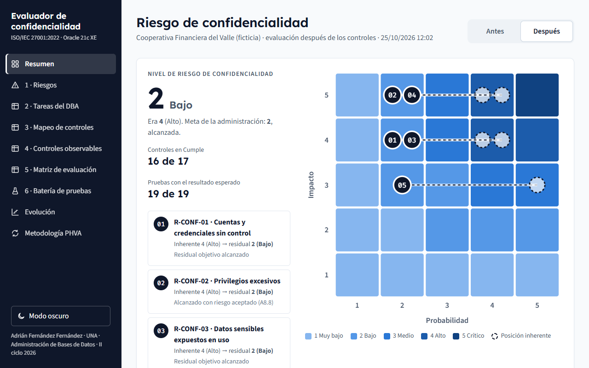
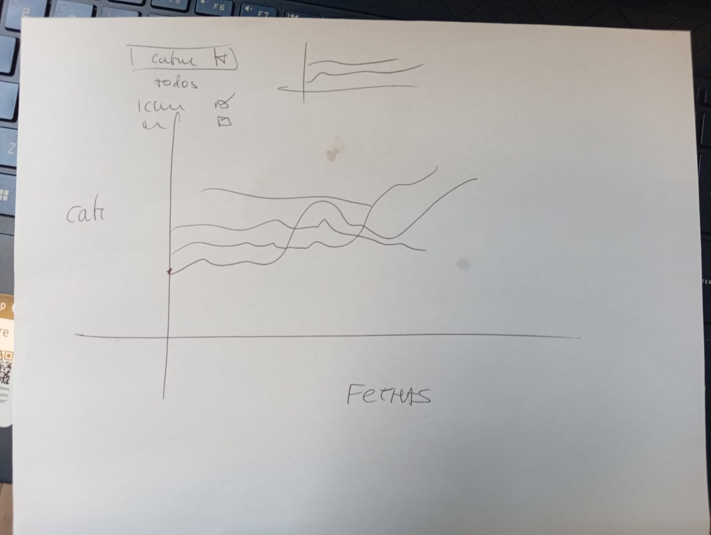
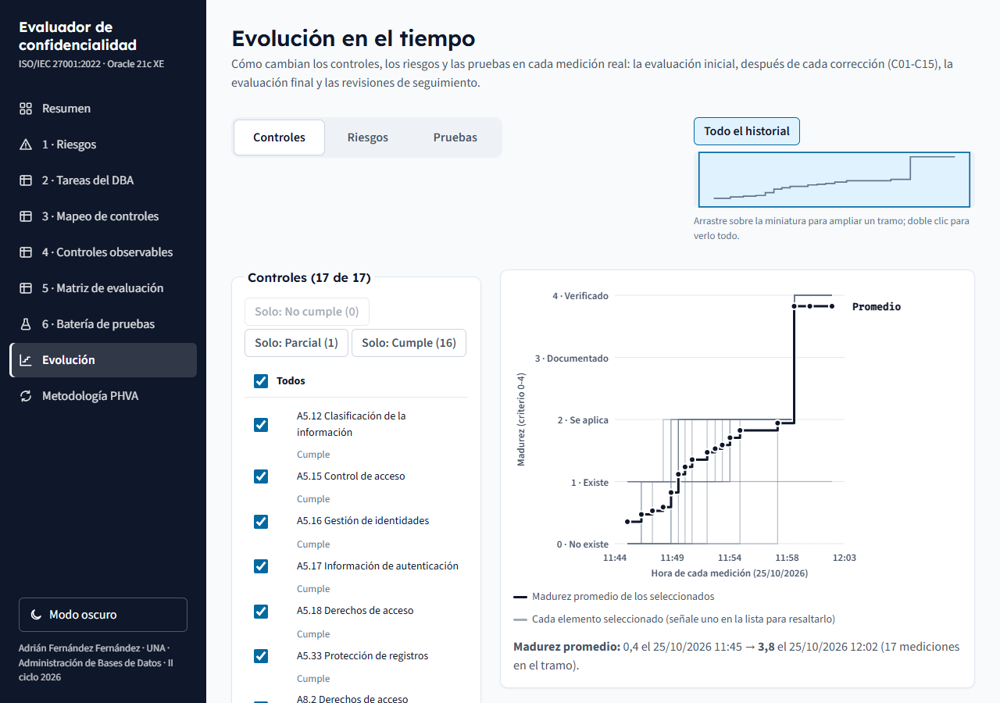
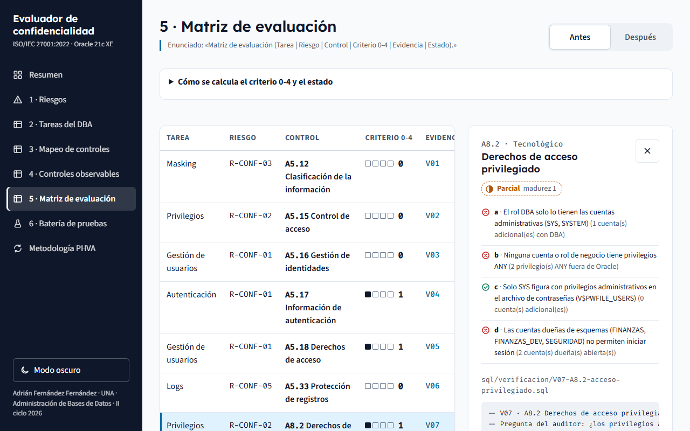
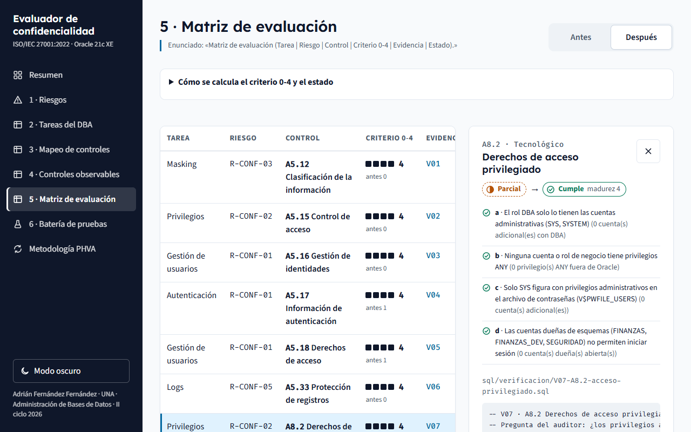
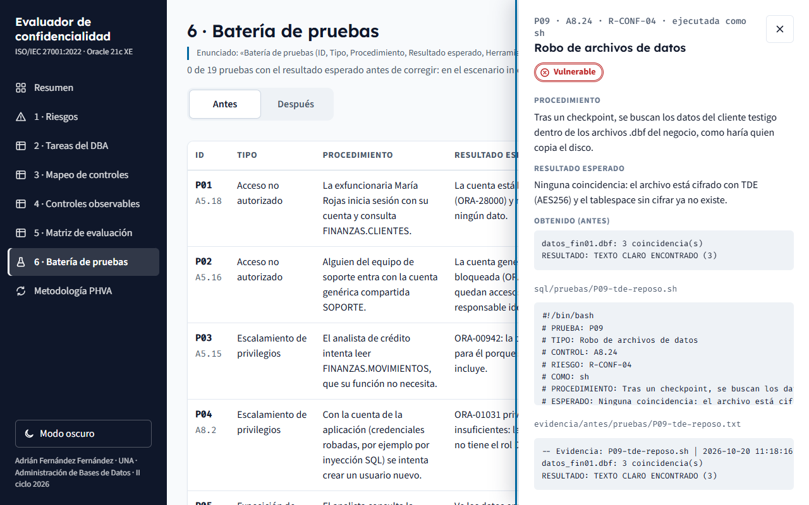
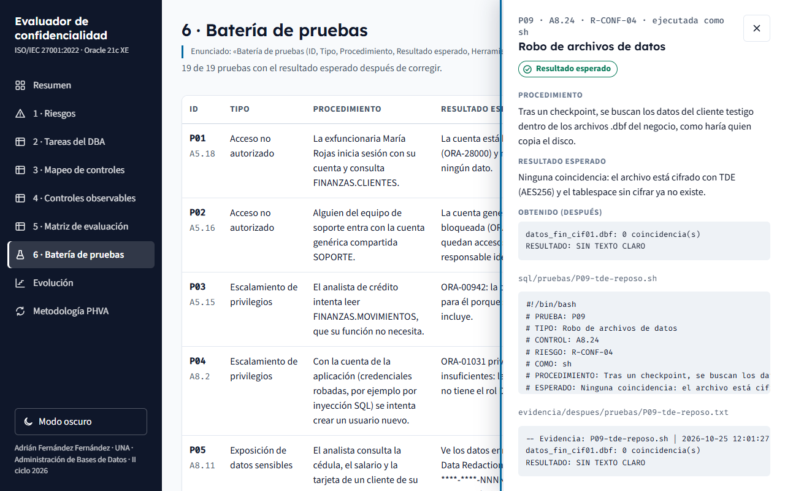
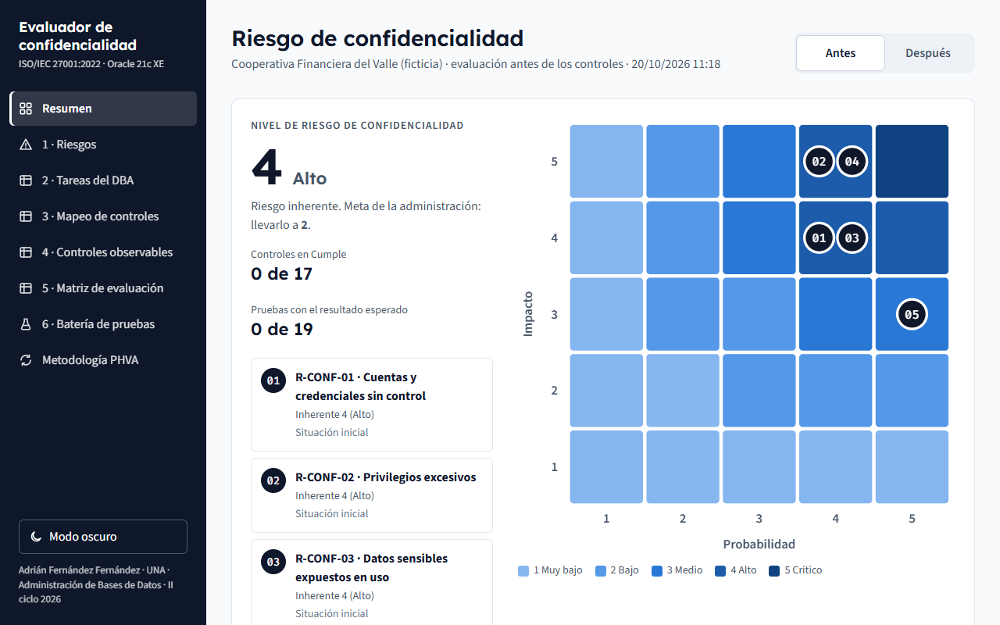

# Controles ISO 27001:2022 para la confidencialidad en la administración de bases de datos

**Seguridad y Auditoría de Bases de Datos**

Universidad Nacional de Costa Rica · Escuela de Informática 
Curso: Administración de Bases de Datos · II Ciclo 2026 
Profesor: Johnny Villalobos Murillo

Estudiante: **Adrián Fernández Fernández**

Fecha de entrega: ____________

| Recurso | Enlace |
| --- | --- |
| Repositorio Git | https://github.com/Adrian123CRff/BD-ISO27001 |
| Artefacto interactivo | Carpeta `app/` del repositorio (ver la sección 6.1) |
| Video explicativo (5 minutos) | ____________ |

## Contenido

1. Introducción
2. Objetivos
3. Competencias desarrolladas
4. Escenario de evaluación
5. Marco teórico
6. Artefacto: evaluador del riesgo de confidencialidad
7. Herramienta y metodología
8. Resultados: comparativa antes y después
9. Análisis de resultados
10. Conclusiones
11. Uso ético y documentado de inteligencia artificial
12. Referencias
- Anexo A. Entregables
- Anexo B. Correspondencia con la rúbrica

<!-- Cómo mantener este documento:
     - Los bloques entre "generado:" y "/generado:" los reescribe `node scripts/generar-informe.mts` a partir de los
       datos del artefacto, de docs/uso-ia.md y de las capturas. No editarlos a mano: se perderían al regenerar.
     - Los recuadros "REDACTA EL ESTUDIANTE" se reemplazan por el texto propio del estudiante.
     - El mismo comando genera docs/informe.pdf. -->

## 1. Introducción

> **REDACTA EL ESTUDIANTE**
>
> Apoyo (sección 1 del enunciado, "Presentación y Justificación"):
> - La confidencialidad como pilar de la seguridad de la información y el DBA como custodio técnico de los activos
>   más críticos.
> - Qué se hizo: un marco de controles ISO/IEC 27001:2022 y 27002:2022 aplicado a una base Oracle real, con el ciclo
>   PHVA y el principio de mínimo privilegio.
> - Qué aporta: cada control se mide con un script que cualquiera puede repetir, no con una opinión.
> - Cómo está organizado el informe.

## 2. Objetivos

**Objetivo general.** Diseñar e implementar un marco de controles basado en ISO/IEC 27001:2022 (Anexo A) e ISO/IEC
27002:2022 para mitigar riesgos de confidencialidad en las tareas del Administrador de Bases de Datos, incluyendo
matriz de evaluación y pruebas observables auditables.

| Objetivo específico (texto del enunciado) | Dónde se cumple |
| --- | --- |
| Identificar y clasificar al menos 5 riesgos de confidencialidad (R-CONF) asociados a motores de BD (Oracle). | Sección 6.3: cinco factores de riesgo con clasificación, impacto, probabilidad y nivel. |
| Mapear al menos 12 tareas críticas del DBA (gestión de usuarios, privilegios, autenticación, cifrado TDE, masking, backup, auditoría, parcheo, listener, eliminación segura, logs, clones DEV/TEST). | Sección 6.4: las 12 tareas, con los riesgos y controles de cada una. |
| Seleccionar y justificar controles del Anexo A 2022 pertinentes (A5.12, A5.15, A5.16, A5.17, A5.18, A5.33, A8.2, A8.3, A8.5, A8.10, A8.11, A8.12, A8.13, A8.15, A8.20). | Sección 6.5: los 15 controles con justificación, implementación sugerida y evidencia observable, más A8.24 y A8.8 como complementarios. |
| Diseñar una Matriz de Evaluación con criterios de madurez 0-4, evidencia y estado (Cumple/No cumple/Parcial). | Sección 6.7 y sección 8. |
| Proponer y ejecutar pruebas técnicas (consultas SQL, revisión de configuraciones, auditorías) que demuestren la efectividad de los controles. | Sección 6.8: 19 pruebas ejecutadas antes y después de corregir. |

## 3. Competencias desarrolladas

| Competencia (sección 4 del enunciado) | Dónde se evidencia en el proyecto |
| --- | --- |
| Administración segura de BD | Correcciones C01-C15 en `sql/correccion/`, aplicadas sobre Oracle 21c XE. |
| Implementación de controles ISO 27001 | Mapeo y matriz de los 15 controles (secciones 6.5 y 6.7). |
| Auditoría de privilegios | Verificaciones V02, V05 y V07 (`DBA_SYS_PRIVS`, `DBA_ROLE_PRIVS`, `V$PWFILE_USERS`) con el usuario de solo lectura ISO_AUDITOR. |
| Gestión de identidades y accesos (IAM/PAM) | Registro de identidades con responsable, perfiles, bloqueo de cuentas y retiro de privilegios administrativos (C04, C05; pruebas P01-P04). |
| Cifrado y enmascaramiento de datos | TDE (C02, C03; P09), respaldos cifrados (C13; P10), red cifrada (C12; P11) y Data Redaction (C07; P05). |
| Cumplimiento Ley de Protección de Datos 8968 Costa Rica | Clasificación de cada columna personal según la categoría de la Ley 8968 (C06; P16). |
| Genéricas: pensamiento crítico, trabajo autónomo, comunicación técnica, ética profesional, aprendizaje continuo | Análisis de resultados (sección 9), artefacto interactivo, datos sintéticos y uso de IA documentado (sección 11). |

## 4. Escenario de evaluación

El caso es el que se planteó en clase: un cliente del sector financiero, supervisado y sujeto a control interno,
cuyo riesgo de confidencialidad es **4 (Alto)** y que la administración quiere llevar a **2 (Bajo)**. Para
reproducirlo se creó la **Cooperativa Financiera del Valle**, una entidad ficticia, en Oracle Database 21c XE
(`sql/01-escenario.sql`).

- **Datos:** 200 clientes con cédula, correo, teléfono, salario y número de tarjeta; 300 cuentas y 3000 movimientos.
  Todos son **sintéticos**: no se trató ningún dato personal real.
- **Debilidades reproducidas a propósito**, cada una asociada a un factor de riesgo y al control que la detecta:

| Debilidad del escenario | Factor | Control |
| --- | --- | --- |
| La exfuncionaria MROJAS conserva su cuenta y su acceso a los clientes | R-CONF-01 | A5.18 |
| Cuenta genérica SOPORTE, compartida y sin dueño | R-CONF-01 | A5.16 |
| Perfil DEFAULT sin límite de intentos, sin vencimiento y sin función de complejidad | R-CONF-01 | A5.17, A8.5 |
| La cuenta de la aplicación (APP_WEB) tiene el rol DBA; el analista, SELECT ANY TABLE | R-CONF-02 | A8.2, A5.15 |
| Clientes y cuentas legibles por PUBLIC; sin restricción por fila | R-CONF-02 | A5.15, A8.3 |
| Datos personales sin clasificar y visibles completos | R-CONF-03 | A5.12, A8.11 |
| Clon de desarrollo con una copia completa de los datos reales | R-CONF-03 | A8.11 |
| Tabla con datos personales borrada pero recuperable desde la papelera | R-CONF-03 | A8.10 |
| Directorio de exportación abierto a PUBLIC y Data Pump para el analista | R-CONF-04 | A8.12 |
| Tablespace, respaldos y tráfico de red sin cifrar | R-CONF-04 | A8.24, A8.13, A8.20 |
| Auditoría apagada; SOPORTE puede borrar la pista de auditoría | R-CONF-05 | A8.15, A5.33 |

## 5. Marco teórico

> **REDACTA EL ESTUDIANTE** (2-3 páginas en total, un apartado por tema)
>
> El esquema completo, con ideas clave, su aplicación en el laboratorio y el estado de verificación de cada fuente,
> está en `docs/marco-teorico-esquema.md`. Abajo, las viñetas de apoyo de cada tema.

### 5.1 Cambios ISO 27001:2022 respecto a 2013: nuevo Anexo A con 93 controles en 4 temas.

> **REDACTA EL ESTUDIANTE**
>
> - De 114 controles en 14 dominios a 93 controles en 4 temas (organizacionales, personas, físicos, tecnológicos).
> - Controles fusionados y 11 nuevos; tres nuevos son centrales aquí: 8.10, 8.11 y 8.12.
> - Atributos de cada control en ISO/IEC 27002:2022; transición de certificaciones hasta el 31/10/2025.
> - En el laboratorio: los 15 controles pertenecen a los temas 5 y 8.

### 5.2 Principio de mínimo privilegio y separación de funciones en el rol DBA.

> **REDACTA EL ESTUDIANTE**
>
> - Mínimo privilegio (Saltzer y Schroeder, 1975; NIST SP 800-53, AC-6) y separación de funciones (AC-5).
> - El DBA tiene acceso técnico a todo: no debe auditarse a sí mismo y sus operaciones deben quedar registradas
>   fuera de su alcance.
> - En el laboratorio: la aplicación perdió el rol DBA, el auditor (ISO_AUDITOR) solo lee el diccionario y las
>   operaciones de SYS se registran en el sistema operativo.

### 5.3 Defensa en profundidad y Zero Trust aplicado a bases de datos.

> **REDACTA EL ESTUDIANTE**
>
> - Capas independientes: la falla de una no expone los datos.
> - Zero Trust (NIST SP 800-207): sin confianza implícita por ubicación o por ser cuenta "interna".
> - En el laboratorio: red cifrada → autenticación → roles → VPD → Data Redaction → TDE → respaldos cifrados →
>   auditoría.

### 5.4 Controles técnicos: Transparent Data Encryption (TDE), Dynamic Data Masking, Data Redaction, Row Level Security / VPD, TLS para conexiones.

> **REDACTA EL ESTUDIANTE**
>
> - TDE cifra en reposo con claves en un monedero aparte; protege contra la copia de archivos, no contra usuarios
>   autorizados.
> - Dynamic Data Masking (SQL Server) y Data Redaction (Oracle) enmascaran el resultado sin cambiar el dato.
> - Row Level Security / VPD agrega una condición por usuario a cada consulta.
> - TLS frente al cifrado nativo de Oracle Net (el que usa el laboratorio): explicar la diferencia.

### 5.5 Data Leakage Prevention (DLP) y gestión de backups cifrados.

> **REDACTA EL ESTUDIANTE**
>
> - DLP (8.12): cerrar las vías de salida: Data Pump, directorios, UTL_FILE, UTL_HTTP y copias de archivos.
> - Respaldos cifrados (8.13): un respaldo legible equivale a robar la base; RMAN cifra con el monedero de TDE.
> - Un respaldo solo cuenta si se valida (RESTORE DATABASE VALIDATE).

### 5.6 Logging, monitoreo y correlación (SIEM).

> **REDACTA EL ESTUDIANTE**
>
> - Registro (8.15), protección de registros (5.33) y monitoreo (8.16).
> - SIEM: centraliza y correlaciona fuentes; ciclo de vida del log (NIST SP 800-92).
> - En el laboratorio: auditoría con texto SQL, revisión semanal con bitácora y pista protegida.

### 5.7 Normativa costarricense: Ley 8968 Protección de la persona frente al tratamiento de sus datos personales y su reglamento.

> **REDACTA EL ESTUDIANTE**
>
> - Ley 8968 (2011) y PRODHAB; reglamento: Decreto Ejecutivo 37554-JP.
> - Deber de seguridad del responsable de la base de datos; categorías de datos (confirmar el artículo en el SCIJ).
> - Los controles de confidencialidad son la forma técnica de cumplir ese deber.

## 6. Artefacto: evaluador del riesgo de confidencialidad

### 6.1 Acceso al artefacto interactivo

El artefacto es una aplicación web (React, Vite y TypeScript) que reúne los seis puntos de la sección 6 del enunciado.
No se conecta a la base: muestra los resultados de una corrida real del laboratorio, y cada fila trae el script SQL
exacto y la salida que produjo, para que cualquiera pueda comprobarla. Así se abre sin Docker y sin exponer ninguna
contraseña.

- Código y datos: carpeta `app/` de https://github.com/Adrian123CRff/BD-ISO27001
- Para abrirlo: `cd app`, `npm install`, `npm run build` y `npx vite preview` (http://localhost:4173).
- Las tablas de esta sección se generan de los mismos datos que usa la aplicación (`docs/artefacto.md`).

<!-- generado: artefacto -->

### 6.2 Escalas

**Impacto** (sobre la confidencialidad) y **probabilidad**, de 1 a 5:

| Valor | Impacto | Significado | Probabilidad | Significado |
| --- | --- | --- | --- | --- |
| 1 | Insignificante | Se expone información interna sin datos personales. | Rara | Requiere que fallen a la vez varios controles verificados. |
| 2 | Menor | Se exponen datos personales de pocos clientes, sin datos financieros. | Improbable | Requiere eludir un control activo y verificado con evidencia. |
| 3 | Moderado | No se expone un dato directamente, pero se pierde la capacidad de detectar o probar un acceso indebido. | Posible | Requiere acceso al servidor o a la red, sin controles que lo impidan. |
| 4 | Mayor | Se exponen datos personales y financieros de clientes (Ley 8968). | Probable | Una prueba lo demostró con una cuenta de negocio existente. |
| 5 | Crítico | Se expone o copia toda la base, o alguien obtiene control administrativo sobre ella. | Casi segura | La debilidad está presente siempre, sin que nadie tenga que actuar. |

**Nivel de riesgo** = ⌈impacto × probabilidad / 5⌉, de 1 (Muy bajo) a 5 (Crítico). El nivel global de
confidencialidad es el del peor factor. Así se expresa la meta del caso de clase: riesgo inherente
4 y residual aceptado 2.

**Madurez 0-4** (definida en clase y aplicada por `scripts/evaluar.ps1`):

| Nivel | Definición de clase | Criterio aplicado |
| --- | --- | --- |
| 0 | No existe. | Ningún criterio técnico del control se cumple. |
| 1 | Existe, pero no se aplica constantemente. | Se cumplen algunos criterios técnicos, no todos. |
| 2 | Se aplica constantemente, pero no está documentado. | Se cumplen todos los criterios técnicos, sin procedimiento aprobado. |
| 3 | Documentado. | Además, hay un procedimiento aprobado en SEGURIDAD.PROCEDIMIENTOS (docs/procedimientos.md). |
| 4 | Documentado, aplicado y verificado con evidencia. | Además, la revisión semanal está activa y dejó registro en los últimos 7 días. |

**Estado**: Cumple: todos los criterios técnicos se cumplen · Parcial: algunos · No cumple: ninguno.

### 6.3 Tabla de riesgos R-CONF-01 a R-CONF-05 con impacto y probabilidad

| ID | Factor de riesgo | Clasificación | Impacto | Probabilidad | Riesgo inherente | Residual objetivo |
| --- | --- | --- | --- | --- | --- | --- |
| R-CONF-01 | Cuentas y credenciales sin control: Cuentas sin dueño, de exfuncionarios o con contraseñas débiles permiten entrar a la base con una identidad válida. | Acceso no autorizado | 4. Con una cuenta válida se leen datos personales y financieros de los clientes. | 4. Demostrado: MROJAS leyó los 200 clientes (P01) y la fuerza bruta no bloqueó la cuenta (P07). | 4 (Alto) | 2 (Bajo): Bajas bloqueadas, identidades con responsable, contraseñas robustas y bloqueo tras 5 intentos (A5.16, A5.17, A5.18, A8.5). |
| R-CONF-02 | Privilegios excesivos: Privilegios administrativos, privilegios ANY o accesos sin restricción por fila permiten ver o controlar más de lo necesario. | Escalamiento de privilegios | 5. Con el rol DBA se controla toda la base: crear usuarios, leer y exportar todo. | 4. Demostrado: APP_WEB creó un usuario (P04) y el analista leyó tablas fuera de su función (P03). | 4 (Alto) | 2 (Bajo): Acceso solo por roles de negocio, sin privilegios ANY, con VPD por cartera y el riesgo de parcheo aceptado formalmente (A5.15, A8.2, A8.3, A8.8). |
| R-CONF-03 | Datos sensibles expuestos en uso: Datos personales sin clasificar, visibles completos, copiados a entornos de prueba o recuperables después de borrarlos. | Exposición de datos sensibles | 4. Se exponen cédula, salario y número de tarjeta de clientes (Ley 8968). | 4. Demostrado: el analista vio la tarjeta completa (P05), el desarrollador vio datos reales (P12) y la copia borrada era recuperable (P14). | 4 (Alto) | 2 (Bajo): Clasificación etiquetada, Data Redaction, clon con datos ficticios controlado y purga semanal (A5.12, A8.10, A8.11). |
| R-CONF-04 | Copias no autorizadas de la información: La información sale de la base por archivos de datos sin cifrar, respaldos legibles, exportaciones o tráfico de red en claro. | Fuga de datos | 5. Una copia del archivo de datos o del respaldo expone toda la base. | 4. Demostrado: el analista escribió un archivo en el servidor (P08) y el texto testigo aparece en claro dentro del archivo de datos (P09). | 4 (Alto) | 2 (Bajo): TDE, respaldos cifrados, vías de exportación cerradas y red cifrada (A8.12, A8.13, A8.20, A8.24). |
| R-CONF-05 | Registros inexistentes o desprotegidos: Sin registros, o con registros que se pueden borrar o leer, un acceso indebido no se detecta ni se puede probar. | Pérdida de trazabilidad | 3. No expone datos por sí mismo, pero impide detectar y probar los demás riesgos. | 5. La auditoría apagada es una condición permanente: ningún acceso queda registrado (P15). | 3 (Medio) | 2 (Bajo): Auditoría con texto SQL, revisión semanal, pista protegida y logs sin permisos para otros (A5.33, A8.15). |

Riesgo inherente global de confidencialidad: **4**. Residual aceptado por la administración: **2**.

Situación de cada factor en el escenario inicial (`sql/01-escenario.sql`):

- **R-CONF-01**: La exfuncionaria MROJAS conserva su cuenta abierta; SOPORTE es una cuenta genérica sin responsable; el perfil DEFAULT no limita intentos ni exige complejidad. Pruebas: P01, P02, P07, P17.
- **R-CONF-02**: APP_WEB tiene el rol DBA; JPEREZ tiene SELECT ANY TABLE; los clientes y cuentas están concedidos a PUBLIC; el motor no tiene parches. Pruebas: P03, P04, P06, P18.
- **R-CONF-03**: Ninguna columna está clasificada; la tarjeta y el salario se ven completos; el clon DEV tiene datos reales; una copia borrada sigue en la papelera. Pruebas: P05, P12, P14, P16.
- **R-CONF-04**: Los datos no están cifrados en disco; no hay respaldos cifrados; PUBLIC puede escribir en un directorio del servidor y usar UTL_FILE; la red no está cifrada. Pruebas: P08, P09, P10, P11.
- **R-CONF-05**: La auditoría está apagada (audit_trail = NONE); SOPORTE puede borrar SYS.AUD$; los logs del servidor son legibles por cualquier usuario. Pruebas: P13, P15, P19.

### 6.4 Tabla de tareas del DBA

| # | Tarea | Qué hace el DBA | Riesgos | Controles |
| --- | --- | --- | --- | --- |
| 1 | Gestión de usuarios | Da de alta cuentas con responsable, bloquea bajas y cuentas genéricas, y revisa los derechos cada semestre. | R-CONF-01 | A5.16, A5.18 |
| 2 | Privilegios | Concede el acceso solo por roles de negocio, retira privilegios administrativos y ANY, y restringe filas con VPD. | R-CONF-02 | A5.15, A8.2, A8.3 |
| 3 | Autenticación | Asigna perfiles con complejidad, vigencia y bloqueo por intentos fallidos, y exige verificadores modernos. | R-CONF-01 | A5.17, A8.5 |
| 4 | Cifrado TDE | Gestiona el monedero y la clave maestra, y mantiene los datos de negocio en un tablespace cifrado. | R-CONF-04 | A8.24 |
| 5 | Masking | Clasifica las columnas personales y las enmascara con Data Redaction para quien no necesita verlas completas. | R-CONF-03 | A5.12, A8.11 |
| 6 | Backup | Toma respaldos RMAN cifrados, los valida y controla las exportaciones (Data Pump, directorios, UTL_FILE). | R-CONF-04 | A8.13, A8.12 |
| 7 | Auditoría | Activa AUDIT con texto SQL sobre sesiones, cuentas, privilegios y lecturas, y deja la revisión semanal. | R-CONF-05 | A8.15 |
| 8 | Parcheo | Revisa versión y parches; si el motor no se puede parchear, documenta la aceptación del riesgo y sus medidas compensatorias. | R-CONF-02 | A8.8 |
| 9 | Listener | Exige cifrado e integridad en Oracle Net e impide cambiar la configuración del listener en caliente. | R-CONF-04 | A8.20 |
| 10 | Eliminación segura | Elimina sin dejar copias recuperables: purga la papelera y borra tablespaces junto con sus archivos. | R-CONF-03 | A8.10 |
| 11 | Logs | Protege la pista de auditoría y los logs del servidor contra borrado, alteración y lectura no autorizada. | R-CONF-05 | A5.33 |
| 12 | Clones DEV/TEST | Genera los clones con datos ficticios y comprueba que no contienen datos reales de producción. | R-CONF-03 | A8.11 |

### 6.5 Mapeo de controles ISO con implementación sugerida y evidencia observable

| Control | Título (ISO/IEC 27002:2022) | Riesgos | Justificación | Implementación sugerida | Evidencia observable |
| --- | --- | --- | --- | --- | --- |
| A5.12 | Clasificación de la información | R-CONF-03 | Sin clasificar no se sabe qué columnas proteger con TDE, redacción o VPD. En el escenario ninguna columna personal estaba etiquetada. | Inventario SEGURIDAD.CLASIFICACION_DATOS con nivel y categoría de la Ley 8968, y etiqueta del nivel en el diccionario (COMMENT ON). (sql/correccion/C06-clasificacion.sql) | SELECT column_name, comments FROM DBA_COL_COMMENTS WHERE owner = 'FINANZAS' AND table_name = 'CLIENTES' (sql/verificacion/V01-A5.12-clasificacion.sql) |
| A5.15 | Control de acceso | R-CONF-02 | El acceso debe responder a la necesidad de conocer. En el escenario los clientes estaban concedidos a PUBLIC y a personas directamente. | Retirar los privilegios a PUBLIC y a personas, y conceder el acceso solo por roles de negocio (ROL_APP_WEB, ROL_ANALISTA_CREDITO, ROL_DESARROLLO). (sql/correccion/C04-roles-privilegios.sql) | SELECT grantee, table_name, privilege FROM DBA_TAB_PRIVS WHERE owner = 'FINANZAS' (sql/verificacion/V02-A5.15-control-acceso.sql) |
| A5.16 | Gestión de identidades | R-CONF-01 | Cada cuenta debe tener un responsable para poder atribuir sus accesos. En el escenario SOPORTE era una cuenta compartida sin dueño. | Registro SEGURIDAD.REGISTRO_IDENTIDADES con tipo, responsable y estado de cada cuenta, incluidas las de la instalación; cuentas genéricas bloqueadas. (sql/correccion/C05-identidades-perfiles.sql) | SELECT username, account_status FROM DBA_USERS WHERE oracle_maintained = 'N' (cruzado con el registro de identidades) (sql/verificacion/V03-A5.16-identidades.sql) |
| A5.17 | Información de autenticación | R-CONF-01 | Una contraseña débil o eterna equivale a una puerta abierta. En el escenario el perfil DEFAULT no exigía complejidad, vigencia ni límite de reutilización. | Perfil PERFIL_USUARIOS con ora12c_strong_verify_function, vigencia de 90 días y sin reutilizar las últimas 5 contraseñas ni en 365 días. (sql/correccion/C05-identidades-perfiles.sql) | SELECT profile, resource_name, limit FROM DBA_PROFILES; SELECT username FROM DBA_USERS_WITH_DEFPWD (sql/verificacion/V04-A5.17-informacion-autenticacion.sql) |
| A5.18 | Derechos de acceso | R-CONF-01 | Los derechos se retiran cuando dejan de necesitarse. En el escenario la exfuncionaria MROJAS conservaba cuenta y acceso a los clientes. | Bloqueo y retiro de privilegios en cada baja, marca BAJA en el registro y revisión semestral de derechos con fecha registrada. (sql/correccion/C04-roles-privilegios.sql, sql/correccion/C05-identidades-perfiles.sql) | SELECT username, account_status, last_login FROM DBA_USERS WHERE oracle_maintained = 'N' (sql/verificacion/V05-A5.18-derechos-acceso.sql) |
| A5.33 | Protección de registros | R-CONF-05 | Un registro que se puede borrar o leer no sirve como prueba. En el escenario SOPORTE podía borrar SYS.AUD$ y los logs del servidor eran legibles por cualquiera. | Retirar DELETE sobre AUD$ y los privilegios DELETE/UPDATE ANY TABLE, auditar su uso, registrar las operaciones de SYS y quitar a "otros" los permisos sobre los logs. (sql/correccion/C04-roles-privilegios.sql, sql/correccion/C11-auditoria.sql, sql/correccion/C15-proteccion-logs.sh) | SELECT grantee, privilege FROM DBA_TAB_PRIVS WHERE table_name = 'AUD$'; SELECT * FROM DBA_PRIV_AUDIT_OPTS (sql/verificacion/V06-A5.33-proteccion-registros.sql) |
| A8.2 | Derechos de acceso privilegiado | R-CONF-02 | Los privilegios administrativos dan acceso a todo. En el escenario la cuenta de la aplicación tenía el rol DBA y el analista SELECT ANY TABLE. | Revocar el rol DBA y los privilegios ANY a cuentas de negocio y bloquear las cuentas dueñas de esquemas. (sql/correccion/C04-roles-privilegios.sql) | SELECT * FROM DBA_SYS_PRIVS; SELECT grantee FROM DBA_ROLE_PRIVS WHERE granted_role = 'DBA'; SELECT * FROM V$PWFILE_USERS (sql/verificacion/V07-A8.2-acceso-privilegiado.sql) |
| A8.3 | Restricción del acceso a la información | R-CONF-02 | Tener acceso a una tabla no implica ver todas sus filas. En el escenario cualquier analista veía los 200 clientes de la cooperativa. | Política VPD VPD_CARTERA_ANALISTA: cada analista ve solo los clientes de su cartera; ninguna cuenta de negocio puede saltarse la política. (sql/correccion/C07-redaccion-vpd.sql) | SELECT object_name, policy_name, enable FROM DBA_POLICIES WHERE object_owner = 'FINANZAS' (sql/verificacion/V08-A8.3-restriccion-acceso.sql) |
| A8.5 | Autenticación segura | R-CONF-01 | Sin límite de intentos, una contraseña se adivina por fuerza bruta. En el escenario los intentos fallidos eran ilimitados. | Bloqueo de la cuenta tras 5 intentos fallidos durante 1 día y verificadores de contraseña mínimos 12a en Oracle Net. (sql/correccion/C05-identidades-perfiles.sql, sql/correccion/C12-red.sh) | SELECT resource_name, limit FROM DBA_PROFILES WHERE resource_name IN ('FAILED_LOGIN_ATTEMPTS', 'PASSWORD_LOCK_TIME') (sql/verificacion/V09-A8.5-autenticacion-segura.sql) |
| A8.10 | Eliminación de la información | R-CONF-03 | Lo borrado no debe poder recuperarse. En el escenario una copia de los clientes seguía en la papelera de reciclaje. | Purga de la papelera, tarea semanal PURGA_PAPELERA y eliminación del tablespace sin cifrar junto con sus archivos. (sql/correccion/C09-eliminacion.sql, sql/correccion/C03-tde-tablespace.sql) | SELECT owner, original_name FROM DBA_RECYCLEBIN; SELECT job_name, enabled FROM DBA_SCHEDULER_JOBS (sql/verificacion/V10-A8.10-eliminacion.sql) |
| A8.11 | Enmascaramiento de datos | R-CONF-03 | Quien no necesita el dato completo no debe verlo, y los entornos de prueba no deben tener datos reales. En el escenario la tarjeta se veía completa y el clon DEV era una copia de producción. | Data Redaction sobre cédula, tarjeta y salario; clon DEV regenerado con datos ficticios y control que cuenta coincidencias con producción. (sql/correccion/C07-redaccion-vpd.sql, sql/correccion/C10-clon-dev.sql) | SELECT * FROM REDACTION_POLICIES; SELECT column_name, function_type FROM REDACTION_COLUMNS; SELECT * FROM SEGURIDAD.V_CONTROL_CLON_DEV (sql/verificacion/V11-A8.11-enmascaramiento.sql) |
| A8.12 | Prevención de fuga de datos | R-CONF-04 | Hay que cerrar las vías para sacar datos masivamente. En el escenario PUBLIC podía escribir en un directorio del servidor y el analista tenía Data Pump. | Retirar a PUBLIC los directorios y UTL_FILE, UTL_HTTP, UTL_TCP y UTL_SMTP, y al analista el rol de exportación, comprobando que no quedan objetos inválidos. (sql/correccion/C08-fuga-datos.sql) | SELECT grantee, table_name, privilege FROM DBA_TAB_PRIVS WHERE type = 'DIRECTORY' OR table_name LIKE 'UTL\_%' ESCAPE '\' (sql/verificacion/V12-A8.12-fuga-datos.sql) |
| A8.13 | Respaldo de la información | R-CONF-04 | Un respaldo robado expone la base si no está cifrado, y uno ilegible no sirve. En el escenario no había respaldos. | RMAN en modo ARCHIVELOG con cifrado AES256, autorespaldo del controlfile, retención y prueba de restauración (RESTORE DATABASE VALIDATE). (sql/correccion/C13-respaldo.sh) | SELECT name, value FROM V$RMAN_CONFIGURATION; SELECT encrypted, completion_time FROM V$BACKUP_PIECE (sql/verificacion/V13-A8.13-respaldo.sql) |
| A8.15 | Registro (logging) | R-CONF-05 | Sin registro no se detecta ni se prueba un acceso indebido. En el escenario la auditoría estaba apagada (audit_trail = NONE). | Auditoría tradicional con texto SQL (DB, EXTENDED) de sesiones, cuentas, privilegios y lecturas de datos personales, con revisión semanal registrada. (sql/correccion/C01-parametros-cdb.sql, sql/correccion/C11-auditoria.sql, sql/correccion/C14-gobierno.sql) | SELECT * FROM DBA_STMT_AUDIT_OPTS; SELECT * FROM DBA_OBJ_AUDIT_OPTS; SELECT * FROM DBA_AUDIT_TRAIL (sql/verificacion/V14-A8.15-registro.sql) |
| A8.20 | Seguridad de las redes | R-CONF-04 | Los datos no deben poder leerse capturando la red. En el escenario el tráfico entre clientes y base viajaba sin cifrar. | Cifrado AES256 e integridad SHA256 obligatorios en Oracle Net (sqlnet.ora) y listener con ADMIN_RESTRICTIONS. (sql/correccion/C12-red.sh) | SELECT network_service_banner FROM V$SESSION_CONNECT_INFO (y revisión de sqlnet.ora y listener.ora, el equivalente de pg_hba.conf) (sql/verificacion/V15-A8.20-redes.sql) |
| A8.24 (complementario) | Uso de criptografía | R-CONF-04 | Complementario para la tarea "cifrado TDE". Quien copia el archivo de datos no debe poder leerlo. En el escenario el texto testigo aparecía en claro dentro del .dbf. | Monedero de TDE con clave maestra y apertura automática local, y datos de negocio en el tablespace cifrado DATOS_FIN_CIF (AES256). (sql/correccion/C01-parametros-cdb.sql, sql/correccion/C02-tde-monedero.sql, sql/correccion/C03-tde-tablespace.sql) | SELECT * FROM V$ENCRYPTION_WALLET; SELECT tablespace_name, encrypted FROM DBA_TABLESPACES (sql/verificacion/V16-A8.24-criptografia-tde.sql) |
| A8.8 (complementario) | Gestión de las vulnerabilidades técnicas | R-CONF-02 | Complementario para la tarea "parcheo". Oracle 21c XE no recibe Release Updates: la exposición se evalúa y el riesgo se acepta formalmente con medidas compensatorias. | Aceptación del riesgo registrada (RIESGO ACEPTADO), cuentas internas cerradas, puerto solo en 127.0.0.1, red cifrada y plan de migración a una versión con parches. (sql/correccion/C14-gobierno.sql) | SELECT * FROM DBA_REGISTRY_SQLPATCH; SELECT username FROM DBA_USERS WHERE oracle_maintained = 'Y' AND account_status = 'OPEN' (sql/verificacion/V17-A8.8-vulnerabilidades.sql) |

### 6.6 Lista de 15 controles observables por auditor externo

Cada control se observa con una consulta de solo lectura al diccionario, ejecutada como ISO_AUDITOR (el mismo privilegio que tendría un auditor externo):

1. **A5.12 Clasificación de la información**: `SELECT column_name, comments FROM DBA_COL_COMMENTS WHERE owner = 'FINANZAS' AND table_name = 'CLIENTES'`. Script: `sql/verificacion/V01-A5.12-clasificacion.sql` (ISO_AUDITOR, solo lectura).
2. **A5.15 Control de acceso**: `SELECT grantee, table_name, privilege FROM DBA_TAB_PRIVS WHERE owner = 'FINANZAS'`. Script: `sql/verificacion/V02-A5.15-control-acceso.sql` (ISO_AUDITOR, solo lectura).
3. **A5.16 Gestión de identidades**: `SELECT username, account_status FROM DBA_USERS WHERE oracle_maintained = 'N' (cruzado con el registro de identidades)`. Script: `sql/verificacion/V03-A5.16-identidades.sql` (ISO_AUDITOR, solo lectura).
4. **A5.17 Información de autenticación**: `SELECT profile, resource_name, limit FROM DBA_PROFILES; SELECT username FROM DBA_USERS_WITH_DEFPWD`. Script: `sql/verificacion/V04-A5.17-informacion-autenticacion.sql` (ISO_AUDITOR, solo lectura).
5. **A5.18 Derechos de acceso**: `SELECT username, account_status, last_login FROM DBA_USERS WHERE oracle_maintained = 'N'`. Script: `sql/verificacion/V05-A5.18-derechos-acceso.sql` (ISO_AUDITOR, solo lectura).
6. **A5.33 Protección de registros**: `SELECT grantee, privilege FROM DBA_TAB_PRIVS WHERE table_name = 'AUD$'; SELECT * FROM DBA_PRIV_AUDIT_OPTS`. Script: `sql/verificacion/V06-A5.33-proteccion-registros.sql` (ISO_AUDITOR, solo lectura).
7. **A8.2 Derechos de acceso privilegiado**: `SELECT * FROM DBA_SYS_PRIVS; SELECT grantee FROM DBA_ROLE_PRIVS WHERE granted_role = 'DBA'; SELECT * FROM V$PWFILE_USERS`. Script: `sql/verificacion/V07-A8.2-acceso-privilegiado.sql` (ISO_AUDITOR, solo lectura).
8. **A8.3 Restricción del acceso a la información**: `SELECT object_name, policy_name, enable FROM DBA_POLICIES WHERE object_owner = 'FINANZAS'`. Script: `sql/verificacion/V08-A8.3-restriccion-acceso.sql` (ISO_AUDITOR, solo lectura).
9. **A8.5 Autenticación segura**: `SELECT resource_name, limit FROM DBA_PROFILES WHERE resource_name IN ('FAILED_LOGIN_ATTEMPTS', 'PASSWORD_LOCK_TIME')`. Script: `sql/verificacion/V09-A8.5-autenticacion-segura.sql` (ISO_AUDITOR, solo lectura).
10. **A8.10 Eliminación de la información**: `SELECT owner, original_name FROM DBA_RECYCLEBIN; SELECT job_name, enabled FROM DBA_SCHEDULER_JOBS`. Script: `sql/verificacion/V10-A8.10-eliminacion.sql` (ISO_AUDITOR, solo lectura).
11. **A8.11 Enmascaramiento de datos**: `SELECT * FROM REDACTION_POLICIES; SELECT column_name, function_type FROM REDACTION_COLUMNS; SELECT * FROM SEGURIDAD.V_CONTROL_CLON_DEV`. Script: `sql/verificacion/V11-A8.11-enmascaramiento.sql` (ISO_AUDITOR, solo lectura).
12. **A8.12 Prevención de fuga de datos**: `SELECT grantee, table_name, privilege FROM DBA_TAB_PRIVS WHERE type = 'DIRECTORY' OR table_name LIKE 'UTL\_%' ESCAPE '\'`. Script: `sql/verificacion/V12-A8.12-fuga-datos.sql` (ISO_AUDITOR, solo lectura).
13. **A8.13 Respaldo de la información**: `SELECT name, value FROM V$RMAN_CONFIGURATION; SELECT encrypted, completion_time FROM V$BACKUP_PIECE`. Script: `sql/verificacion/V13-A8.13-respaldo.sql` (ISO_AUDITOR, solo lectura).
14. **A8.15 Registro (logging)**: `SELECT * FROM DBA_STMT_AUDIT_OPTS; SELECT * FROM DBA_OBJ_AUDIT_OPTS; SELECT * FROM DBA_AUDIT_TRAIL`. Script: `sql/verificacion/V14-A8.15-registro.sql` (ISO_AUDITOR, solo lectura).
15. **A8.20 Seguridad de las redes**: `SELECT network_service_banner FROM V$SESSION_CONNECT_INFO (y revisión de sqlnet.ora y listener.ora, el equivalente de pg_hba.conf)`. Script: `sql/verificacion/V15-A8.20-redes.sql` (ISO_AUDITOR, solo lectura).

Complementarios (tareas "cifrado TDE" y "parcheo"):

16. **A8.24 Uso de criptografía**: `SELECT * FROM V$ENCRYPTION_WALLET; SELECT tablespace_name, encrypted FROM DBA_TABLESPACES`. Script: `sql/verificacion/V16-A8.24-criptografia-tde.sql` (ISO_AUDITOR, solo lectura).
17. **A8.8 Gestión de las vulnerabilidades técnicas**: `SELECT * FROM DBA_REGISTRY_SQLPATCH; SELECT username FROM DBA_USERS WHERE oracle_maintained = 'Y' AND account_status = 'OPEN'`. Script: `sql/verificacion/V17-A8.8-vulnerabilidades.sql` (ISO_AUDITOR, solo lectura).

### 6.7 Matriz de evaluación (Tarea | Riesgo | Control | Criterio 0-4 | Evidencia | Estado)

Antes: 2026-10-25T11:45:52 · Después: 2026-10-25T12:02:11 · Oracle Database 21c Express Edition 21.3.0.0.0 (contenedor iso-lab, XEPDB1) · Ejecutado como ISO_AUDITOR (solo lectura del diccionario).

| Tarea | Riesgo | Control | Criterio 0-4 (antes → después) | Evidencia | Estado (antes → después) |
| --- | --- | --- | --- | --- | --- |
| Masking | R-CONF-03 | A5.12 Clasificación de la información | 0 → 4 | sql/verificacion/V01-A5.12-clasificacion.sql; evidencia/antes y evidencia/despues/V01-A5.12-clasificacion.txt | No cumple (0/3) → Cumple (3/3) |
| Privilegios | R-CONF-02 | A5.15 Control de acceso | 0 → 4 | sql/verificacion/V02-A5.15-control-acceso.sql; evidencia/antes y evidencia/despues/V02-A5.15-control-acceso.txt | No cumple (0/3) → Cumple (3/3) |
| Gestión de usuarios | R-CONF-01 | A5.16 Gestión de identidades | 0 → 4 | sql/verificacion/V03-A5.16-identidades.sql; evidencia/antes y evidencia/despues/V03-A5.16-identidades.txt | No cumple (0/2) → Cumple (2/2) |
| Autenticación | R-CONF-01 | A5.17 Información de autenticación | 1 → 4 | sql/verificacion/V04-A5.17-informacion-autenticacion.sql; evidencia/antes y evidencia/despues/V04-A5.17-informacion-autenticacion.txt | Parcial (1/4) → Cumple (4/4) |
| Gestión de usuarios | R-CONF-01 | A5.18 Derechos de acceso | 1 → 4 | sql/verificacion/V05-A5.18-derechos-acceso.sql; evidencia/antes y evidencia/despues/V05-A5.18-derechos-acceso.txt | Parcial (1/3) → Cumple (3/3) |
| Logs | R-CONF-05 | A5.33 Protección de registros | 0 → 4 | sql/verificacion/V06-A5.33-proteccion-registros.sql; evidencia/antes y evidencia/despues/V06-A5.33-proteccion-registros.txt | No cumple (0/3) → Cumple (3/3) |
| Privilegios | R-CONF-02 | A8.2 Derechos de acceso privilegiado | 1 → 4 | sql/verificacion/V07-A8.2-acceso-privilegiado.sql; evidencia/antes y evidencia/despues/V07-A8.2-acceso-privilegiado.txt | Parcial (1/4) → Cumple (4/4) |
| Privilegios | R-CONF-02 | A8.3 Restricción del acceso a la información | 0 → 4 | sql/verificacion/V08-A8.3-restriccion-acceso.sql; evidencia/antes y evidencia/despues/V08-A8.3-restriccion-acceso.txt | No cumple (0/3) → Cumple (3/3) |
| Autenticación | R-CONF-01 | A8.5 Autenticación segura | 1 → 4 | sql/verificacion/V09-A8.5-autenticacion-segura.sql; evidencia/antes y evidencia/despues/V09-A8.5-autenticacion-segura.txt | Parcial (2/3) → Cumple (3/3) |
| Eliminación segura | R-CONF-03 | A8.10 Eliminación de la información | 1 → 4 | sql/verificacion/V10-A8.10-eliminacion.sql; evidencia/antes y evidencia/despues/V10-A8.10-eliminacion.txt | Parcial (1/3) → Cumple (3/3) |
| Masking, Clones DEV/TEST | R-CONF-03 | A8.11 Enmascaramiento de datos | 0 → 4 | sql/verificacion/V11-A8.11-enmascaramiento.sql; evidencia/antes y evidencia/despues/V11-A8.11-enmascaramiento.txt | No cumple (0/3) → Cumple (3/3) |
| Backup | R-CONF-04 | A8.12 Prevención de fuga de datos | 0 → 4 | sql/verificacion/V12-A8.12-fuga-datos.sql; evidencia/antes y evidencia/despues/V12-A8.12-fuga-datos.txt | No cumple (0/3) → Cumple (3/3) |
| Backup | R-CONF-04 | A8.13 Respaldo de la información | 0 → 4 | sql/verificacion/V13-A8.13-respaldo.sql; evidencia/antes y evidencia/despues/V13-A8.13-respaldo.txt | No cumple (0/3) → Cumple (3/3) |
| Auditoría | R-CONF-05 | A8.15 Registro (logging) | 0 → 4 | sql/verificacion/V14-A8.15-registro.sql; evidencia/antes y evidencia/despues/V14-A8.15-registro.txt | No cumple (0/5) → Cumple (5/5) |
| Listener | R-CONF-04 | A8.20 Seguridad de las redes | 0 → 4 | sql/verificacion/V15-A8.20-redes.sql; evidencia/antes y evidencia/despues/V15-A8.20-redes.txt | No cumple (0/2) → Cumple (2/2) |
| Cifrado TDE | R-CONF-04 | A8.24 Uso de criptografía | 0 → 4 | sql/verificacion/V16-A8.24-criptografia-tde.sql; evidencia/antes y evidencia/despues/V16-A8.24-criptografia-tde.txt | No cumple (0/3) → Cumple (3/3) |
| Parcheo | R-CONF-02 | A8.8 Gestión de las vulnerabilidades técnicas | 1 → 1 | sql/verificacion/V17-A8.8-vulnerabilidades.sql; evidencia/antes y evidencia/despues/V17-A8.8-vulnerabilidades.txt | Parcial (2/3) → Parcial (2/3) |

A8.8 queda en Parcial a propósito: Oracle 21c XE no recibe Release Updates y el riesgo está aceptado formalmente (`docs/procedimientos.md#a88`).

### 6.8 Batería de pruebas (ID, Tipo, Procedimiento, Resultado esperado, Herramienta)

| ID | Tipo | Procedimiento | Resultado esperado | Herramienta | Control · Riesgo | Antes | Después |
| --- | --- | --- | --- | --- | --- | --- | --- |
| P01 | Acceso no autorizado | La exfuncionaria María Rojas inicia sesión con su cuenta y consulta FINANZAS.CLIENTES. | La cuenta está bloqueada (ORA-28000) y no obtiene ningún dato. | SQL*Plus (equivalente en SQL Developer) | A5.18 · R-CONF-01 | Vulnerable / no obtenido | Resultado esperado |
| P02 | Acceso no autorizado | Alguien del equipo de soporte entra con la cuenta genérica compartida SOPORTE. | La cuenta genérica está bloqueada (ORA-28000): no quedan accesos sin un responsable identificable. | SQL*Plus | A5.16 · R-CONF-01 | Vulnerable / no obtenido | Resultado esperado |
| P03 | Escalamiento de privilegios | El analista de crédito intenta leer FINANZAS.MOVIMIENTOS, que su función no necesita. | ORA-00942: la tabla no existe para él porque su rol no la incluye. | SQL*Plus | A5.15 · R-CONF-02 | Vulnerable / no obtenido | Resultado esperado |
| P04 | Escalamiento de privilegios | Con la cuenta de la aplicación (credenciales robadas, por ejemplo por inyección SQL) se intenta crear un usuario nuevo. | ORA-01031 privilegios insuficientes: la aplicación ya no tiene el rol DBA. | SQL*Plus | A8.2 · R-CONF-02 | Vulnerable / no obtenido | Resultado esperado |
| P05 | Exposición de datos sensibles | El analista consulta la cédula, el salario y la tarjeta de un cliente de su cartera. | Ve los datos enmascarados por Data Redaction: tarjeta ****-****-****-NNNN, cédula *-****-NNNN, salario 0. | SQL*Plus | A8.11 · R-CONF-03 | Vulnerable / no obtenido | Resultado esperado |
| P06 | Restricción de acceso por fila | El analista cuenta cuántos clientes puede ver en FINANZAS.CLIENTES. | Solo ve los 50 clientes de su cartera (VPD), no los 200 de la cooperativa. | SQL*Plus | A8.3 · R-CONF-02 | Vulnerable / no obtenido | Resultado esperado |
| P07 | Fuerza bruta | Se prueban 6 contraseñas incorrectas contra DEV_USER y después la correcta. | Tras 5 intentos fallidos la cuenta queda bloqueada (ORA-28000), aunque luego se use la contraseña correcta. | SQL*Plus | A8.5 · R-CONF-01 | Vulnerable / no obtenido | Resultado esperado |
| P08 | Fuga de datos | El analista intenta escribir un archivo con datos en el directorio EXPORTES del servidor usando UTL_FILE. | Falla (PLS-00201 / ORA-29289): ni el paquete ni el directorio están disponibles para él. | SQL*Plus (PL/SQL) | A8.12 · R-CONF-04 | Vulnerable / no obtenido | Resultado esperado |
| P09 | Robo de archivos de datos | Tras un checkpoint, se buscan los datos del cliente testigo dentro de los archivos .dbf del negocio, como haría quien copia el disco. | Ninguna coincidencia: el archivo está cifrado con TDE (AES256) y el tablespace sin cifrar ya no existe. | grep sobre el archivo de datos (sistema operativo del servidor) | A8.24 · R-CONF-04 | Vulnerable / no obtenido | Resultado esperado |
| P10 | Robo de respaldos | Se buscan los datos del cliente testigo dentro de las piezas de respaldo de RMAN (el "BKP" que alguien podría llevarse). | Hay respaldos y ninguna pieza contiene texto claro (respaldo cifrado con AES256). | RMAN + grep sobre las piezas de respaldo | A8.13 · R-CONF-04 | Vulnerable / no obtenido | Resultado esperado |
| P11 | Revisión de configuración | Revisión de sqlnet.ora y listener.ora del servidor (el equivalente en Oracle del pg_hba.conf del enunciado). | Cifrado AES256 e integridad SHA256 en modo REQUIRED y listener con ADMIN_RESTRICTIONS. | Revisión de archivos de configuración de Oracle Net | A8.20 · R-CONF-04 | Vulnerable / no obtenido | Resultado esperado |
| P12 | Exposición en entornos de prueba | El desarrollador consulta en el clon FINANZAS_DEV el registro del cliente testigo. | Solo encuentra datos ficticios ("Cliente de prueba 200"), nunca el nombre o la cédula reales. | SQL*Plus | A8.11 · R-CONF-03 | Vulnerable / no obtenido | Resultado esperado |
| P13 | Alteración de registros | Con la cuenta de soporte se intenta borrar la pista de auditoría (DELETE sobre SYS.AUD$; la condición 1 = 0 evita borrar de verdad). | No es posible: la cuenta está bloqueada o no tiene privilegios (ORA-28000 / ORA-01031 / ORA-00942). | SQL*Plus | A5.33 · R-CONF-05 | Vulnerable / no obtenido | Resultado esperado |
| P14 | Recuperación de datos eliminados | Se comprueba si la tabla borrada CLIENTES_RESPALDO_2025 (u otra del negocio) todavía se puede recuperar con FLASHBACK TABLE ... TO BEFORE DROP. | Nada recuperable en la papelera de los esquemas de negocio. | SQL*Plus (DBA_RECYCLEBIN) | A8.10 · R-CONF-03 | Vulnerable / no obtenido | Resultado esperado |
| P15 | Trazabilidad | Después de P01 a P14, el auditor revisa en DBA_AUDIT_TRAIL si quedaron registrados los intentos de la última hora. | Aparecen los inicios de sesión fallidos o bloqueados, los accesos denegados y las lecturas de FINANZAS.CLIENTES. | SQL*Plus (DBA_AUDIT_TRAIL) | A8.15 · R-CONF-05 | Vulnerable / no obtenido | Resultado esperado |
| P16 | Revisión de clasificación | Antes de usar los datos, el analista de crédito consulta desde su propia sesión el nivel de clasificación de las columnas personales de FINANZAS.CLIENTES (lo mismo que muestra SQL Developer en la descripción de la tabla). | Las 5 columnas personales (cédula, correo, teléfono, salario y tarjeta) muestran su etiqueta CONFIDENCIAL o RESTRINGIDO. | SQL*Plus (equivalente en SQL Developer: pestaña Columnas, campo Comentarios) | A5.12 · R-CONF-03 | Vulnerable / no obtenido | Resultado esperado |
| P17 | Contraseña débil | Se da de alta una cuenta de prueba con el mismo perfil que el analista de crédito y con la contraseña "abc", como haría quien elige una clave fácil de adivinar. | Oracle rechaza la contraseña (ORA-28003): el perfil exige la función de complejidad ora12c_strong_verify_function. | SQL*Plus | A5.17 · R-CONF-01 | Vulnerable / no obtenido | Resultado esperado |
| P18 | Revisión de vulnerabilidades | El auditor compara la versión y los parches aplicados al motor con la decisión registrada por la cooperativa: un motor sin parches solo es aceptable si hay una aceptación formal del riesgo con medidas compensatorias. | El motor tiene al menos un parche aplicado, o la falta de parches figura como RIESGO ACEPTADO en SEGURIDAD.PROCEDIMIENTOS (XE no recibe Release Updates). | SQL*Plus (DBA_REGISTRY_SQLPATCH y registro de procedimientos) | A8.8 · R-CONF-02 | Vulnerable / no obtenido | Resultado esperado |
| P19 | Revisión de configuración | Se revisan los permisos del sistema operativo sobre los registros y los archivos que revelan la estructura de la base: alert log, trazas y log del listener (diag), auditoría de SYS (adump), y respaldos, archive logs, monedero y archivos de datos (oradata). | Ningún archivo ni directorio es alcanzable por "otros": los directorios raíz están cerrados (sin permisos para otros), así que solo el dueño oracle y su grupo pueden abrir su contenido. Lo que Oracle cree después con permisos abiertos debajo de un directorio cerrado se informa aparte. | stat sobre los directorios de Oracle (sistema operativo del servidor) | A5.33 · R-CONF-05 | Vulnerable / no obtenido | Resultado esperado |

Antes: 0 de 19 con el resultado esperado · Después: 19 de 19. Evidencia en `evidencia/<fase>/pruebas/`.

<!-- /generado: artefacto -->

### 6.9 Evolución en el tiempo (mejora pedida por el profesor)

Al revisar el avance, el profesor pidió un gráfico en el tiempo en el que se elige qué ver y que muestre las fechas.

El artefacto lo incluye en la vista **Evolución**:

- **Qué graficar:** controles (madurez 0-4), factores de riesgo (nivel 1-5, con la meta de 2) o pruebas (cuántas
  obtienen el resultado esperado).
- **Cuáles:** "Todos", una casilla por elemento y filtros rápidos por estado (por ejemplo, solo los controles que
  aún no cumplen).
- **Cuándo:** el eje horizontal es la fecha y hora de cada medición; una miniatura de todo el historial permite
  elegir el tramo que se amplía.
- **De dónde salen los datos:** de mediciones reales, no de valores interpolados. `scripts/corregir.ps1` ejecuta
  `scripts/medir.ps1` después de cada corrección (C01-C15): los 18 scripts de verificación y las 19 pruebas, con su
  evidencia en `evidencia/historial/<etapa>/`. Cada medición queda en `app/src/datos/historial.json`, que la
  aplicación valida al cargar (incluye las evaluaciones oficiales antes y después con la misma fecha).

## 7. Herramienta y metodología

### 7.1 Motor

Oracle Database 21c Express Edition 21.3.0.0.0, en el contenedor Docker `iso-lab` (imagen `gvenzl/oracle-xe:21`),
base conectable `XEPDB1`. Evidencia: `evidencia/preparacion/00-entorno.txt`.

### 7.2 Metodología PHVA

| Fase | Qué se hizo | Scripts | Evidencia |
| --- | --- | --- | --- |
| Planificar | Escenario inicial con las debilidades, análisis de los cinco factores de riesgo y procedimientos de cada control. | `sql/01-escenario.sql`, `sql/02-auditor.sql`, `docs/procedimientos.md` | `evidencia/preparacion/` |
| Hacer | Correcciones en orden, con el reinicio que exigen los parámetros estáticos: TDE, roles, perfiles, clasificación, Data Redaction, VPD, cierre de fugas, purga, clon ficticio, auditoría, red, respaldo, gobierno y permisos de los logs. | `scripts/corregir.ps1` (C01-C15 en `sql/correccion/`) | `evidencia/correccion/` |
| Verificar | Antes y después de corregir: 18 scripts de solo lectura calculan estado y madurez, y 19 pruebas intentan explotar cada debilidad. Después, reinicio de la base para comprobar que el cifrado abre solo. | `scripts/evaluar.ps1`, `scripts/pruebas.ps1` | `evidencia/antes/`, `evidencia/despues/`, `evidencia/reinicio/` |
| Actuar | Revisión semanal programada con bitácora; riesgo de A8.8 aceptado formalmente; errores de los scripts corregidos en el script y la cadena repetida desde cero. | `sql/correccion/C14-gobierno.sql`, `sql/mantenimiento/M02-revision-semanal.sql` | `evidencia/mantenimiento/`, `docs/revision-codigo-seguridad.md` |

Toda la cadena se ejecutó desde un laboratorio vacío, sin pasos manuales; si un paso fallaba, la corrección se hacía
en el script versionado y la cadena se repetía desde el inicio.

### 7.3 Herramientas: SQL Developer

Las verificaciones se ejecutan de forma automática con SQL*Plus y también en SQL Developer, conectado como
ISO_AUDITOR (usuario de solo lectura). El procedimiento está en `docs/guia-sql-developer.md`.

<!-- generado: sql-developer -->

> **PENDIENTE DEL ESTUDIANTE**
>
> Faltan las capturas de SQL Developer en `evidencia/sql-developer/`: `V07-A8.2-sql-developer.png`, `V16-A8.24-sql-developer.png`, `V15-A8.20-sql-developer.png`.
> Se toman siguiendo `docs/guia-sql-developer.md` y se vuelve a ejecutar `node scripts/generar-informe.mts`.

<!-- /generado: sql-developer -->

### 7.4 Documentación

- Referencias en formato APA 7 (sección 12).
- Repositorio Git: https://github.com/Adrian123CRff/BD-ISO27001
- Video explicativo de 5 minutos: ____________

## 8. Resultados: comparativa antes y después

<!-- generado: comparativa -->

Evaluación antes: 25/10/2026 11:45 · después: 25/10/2026 12:02 · Oracle Database 21c Express Edition 21.3.0.0.0 (contenedor iso-lab, XEPDB1) · verificado como ISO_AUDITOR (solo lectura del diccionario).

| Indicador | Antes | Después |
| --- | --- | --- |
| Nivel de riesgo de confidencialidad | 4 (Alto) | 2 (Bajo) |
| Controles en Cumple | 0 | 16 |
| Controles en Parcial | 6 | 1 |
| Controles en No cumple | 11 | 0 |
| Madurez promedio (0-4) | 0,4 | 3,8 |
| Pruebas con el resultado esperado | 0 de 19 | 19 de 19 |

Por factor de riesgo: los controles bajan la probabilidad; el impacto no cambia, porque el dato expuesto sería el mismo.

| Factor | Nombre | Inherente | Controles que lo mitigan (estado después) | Residual |
| --- | --- | --- | --- | --- |
| R-CONF-01 | Cuentas y credenciales sin control | 4 (Alto) | A5.16 Cumple, A5.17 Cumple, A5.18 Cumple, A8.5 Cumple | 2 (Bajo) |
| R-CONF-02 | Privilegios excesivos | 4 (Alto) | A5.15 Cumple, A8.2 Cumple, A8.3 Cumple, A8.8 Parcial | 2 (Bajo) |
| R-CONF-03 | Datos sensibles expuestos en uso | 4 (Alto) | A5.12 Cumple, A8.10 Cumple, A8.11 Cumple | 2 (Bajo) |
| R-CONF-04 | Copias no autorizadas de la información | 4 (Alto) | A8.12 Cumple, A8.13 Cumple, A8.20 Cumple, A8.24 Cumple | 2 (Bajo) |
| R-CONF-05 | Registros inexistentes o desprotegidos | 3 (Medio) | A5.33 Cumple, A8.15 Cumple | 2 (Bajo) |

El detalle por control (criterio 0-4 y estado, antes y después) está en la matriz (sección 6.7) y el de cada prueba en la batería (sección 6.8).

<!-- /generado: comparativa -->

**Matriz de evaluación, control A8.2 (Derechos de acceso privilegiado).** Antes, la evidencia muestra la cuenta de la
aplicación con el rol DBA y dos privilegios ANY: 1 de 4 criterios, madurez 1, Parcial. Después: 4 de 4 criterios,
madurez 4, Cumple.

**Prueba P09 (robo de archivos de datos).** Antes, el texto testigo aparece en claro dentro del archivo de datos; con
TDE, ninguna coincidencia.

**Nivel de riesgo de confidencialidad, antes y después.**

## 9. Análisis de resultados

> **REDACTA EL ESTUDIANTE**
>
> Apoyo:
> - Qué control movió cada factor de riesgo y por qué baja la probabilidad y no el impacto.
> - Hallazgos no previstos durante la ejecución: Data Redaction impidió copiar los datos para el control del clon
>   (ORA-28081); `V$RMAN_BACKUP_JOB_DETAILS` no es visible desde la PDB; Oracle volvió a crear directorios de
>   incidentes con permisos abiertos después de C15 (deriva detectada por P19); la contraseña de SYS quedaba visible
>   en la configuración del contenedor (`docs/revision-codigo-seguridad.md`).
> - La madurez 4 depende del tiempo: exige una revisión semanal de los últimos 7 días.
> - Limitaciones: A8.8 (XE sin parches, riesgo aceptado), cifrado nativo de Oracle Net en lugar de TLS, auditoría
>   tradicional en lugar de unificada, laboratorio en contenedor y datos sintéticos.

## 10. Conclusiones

> **REDACTA EL ESTUDIANTE**
>
> Apoyo:
> - Cumplimiento de cada objetivo específico (sección 2).
> - La meta de la administración (riesgo 4 → 2) y lo que la respalda.
> - Lo aprendido al convertir cada control ISO en una consulta verificable.
> - Trabajo futuro: auditoría unificada, TLS, integración con un SIEM, ACL por defecto en los logs y migración a una
>   versión con parches.

## 11. Uso ético y documentado de inteligencia artificial

Tabla de la sección 8 del enunciado. Cada prompt está transcrito tal como se escribió o dictó; la fuente completa,
con número y fecha, es `docs/uso-ia.md`.

<!-- generado: uso-ia -->

| Herramienta IA | Prompt Exacto Utilizado | Aporte de la IA | Validación / Corrección del Estudiante | Fuente Verificada |
| --- | --- | --- | --- | --- |
| Claude (Claude Code) (1, 17/10/2026) | "C:\Users\Adrian Fernandez\Documents\ChatGPT\Confidencialidad Ok, amigo, mira, te pasé la dirección de una nueva carpeta que vamos a estar trabajando. O sea, va a ser este hilo, pero un nuevo proyecto. Este, en esa carpeta hay tres imágenes de la clase y este, está el contexto, el script del audio de la clase. Y está mis notas, que bueno, ahí un poco importantes, más o menos. Este. Y el enunciado de, del proyecto. Entonces me gustaría que leyeras el script, leyeras mis notas, leyeras el script de la, el, la, el documento del proyecto, asignación ISO 27001, confidencialidad DBA 2, ciclo 2026-1. Y tuvieras también un contexto ahí de las imágenes, de cómo el profesor estaba explicando cómo funcionaba. Él lo que trató de decir al final es que de esas tres imágenes, Iba, o sea, la parte administrativa, administrativa, base de datos y, y la herramienta. Estaba explicando algo de, de Oracle. Que lo fusionáramos en algo de, de... O sea, conectar esos tres mundos por una matriz de evaluación, básicamente. Eso es lo que él trato de decir. Entonces, para este proyecto me gustaría trabajar un poquito diferente. Quiero que en el, la carpeta la digamos como un proyecto normal. Este, quiero también instalar plugins, instalar diferentes este, skills para mejorar, ya sea la parte de diseño que a veces son un poco genéricas, este, algunas reglas. Por ejemplo, como la regla que usa la NASA para la parte de programación. Este, no sé si la puedes encontrar, sería muy importante. Este, plugins o skills de, para mejorar el diseño. Me gustaría que me ayudaras con ello." "Ok, con respecto a lo que el profesor pide en, el docu en la documentación, no quiero que la resumas, hay que hacerlo como el profesor lo especifica en la documentación. Sí tenemos el contexto de la clase, de lo que le estuvo explicando, pero no necesito que resumas lo de la documentación. Eso tiene que estar al pie de la letra, ¿sabes? O sea, tiene que completarse sí o sí." "a 21c XE en un Docker aparte (recomendado): así se cumple al pie de la letra.b) App.React + Vite + TypeScript (recomendado; lo sugirió el profe). c) Repositorio. ya te paso el repo https://github.com/Adrian123CRff/BD-ISO27001.git" | Preparación del proyecto: resumen de la clase y de las pizarras (`docs/contexto-de-clase.md`), transcripción literal del enunciado y lista de cumplimiento (`docs/enunciado-literal.md`, `docs/checklist-enunciado.md`), reglas de código basadas en "Power of 10" (`docs/reglas-de-codigo.md`), contenedor Oracle 21c XE y base de la aplicación | _Pendiente_ | Enunciado del curso (PDF); Holzmann (2006) |
| Claude (Claude Code) (2, 17/10/2026) | Prompt de la Fase 0 (`prompts-claude-code.md`): "Rol: Actúa como DBA Oracle senior y auditor de seguridad de la información con experiencia en ISO/IEC 27001:2022 e ISO/IEC 27002:2022.  Contexto: Este repositorio es mi asignación individual "ISO 27001 – Confidencialidad – DBA 2, ciclo 2026-1". El enunciado literal está en docs/enunciado-literal.md y cada requisito, con su estado, en docs/checklist-enunciado.md. Las reglas de código están en docs/reglas-de-codigo.md y las convenciones del proyecto en CLAUDE.md. El laboratorio es el contenedor Docker iso-lab (Oracle 21c XE, puerto 1526, servicio XEPDB1); las contraseñas están solo en .env.  Tarea: Lee esos archivos, revisa git status, el contenido de sql/, scripts/ y app/, y consulta el estado de iso-lab con .\scripts\iso-lab.ps1 -Estado. Después, entrégame un diagnóstico del avance.  Restricciones: - No modifiques ningún archivo ni la base en esta fase. - No resumas ni reinterpretes el enunciado. Cita cada requisito tal como aparece en docs/enunciado-literal.md.  Criterios de aceptación: Cada requisito del checklist queda clasificado como Cumplido, Parcial o Pendiente, con el archivo que lo respalda o lo que falta.  Entregable: Una tabla requisito → estado → evidencia/faltante, y una lista ordenada de próximos pasos. Al final, agrega este prompt textual como una fila nueva en docs/uso-ia.md." | Diagnóstico del avance (solo lectura): cada requisito del checklist clasificado como Cumplido, Parcial o Pendiente con su evidencia o faltante; hallazgos en el laboratorio (monedero de TDE cerrado tras el reinicio, corrección detenida en C13, evidencia de A5.33 desfasada respecto de su script, procedimientos sin documento); lista ordenada de próximos pasos | _Pendiente_ | `docs/enunciado-literal.md`; salidas de `evidencia/`; consultas de solo lectura a `iso-lab` |
| Claude (Claude Code) y Claude (Claude Desktop) (3, 17-18/10/2026) | "tenia el siguiente documento en el cual coloque en orden los pronts a realizar en promts claude code , veo que definiste las 11 paso, pero me gustaria que con el analisis que me diste revises esos promts y realizar las correciones que sean necesarias" "Este, una pregunta, pero eso será mejor manejarlo con Claude Code. No habíamos quedado con ello. O sea, sí, te dije eso, pero mejor hacerlo con Claude Code. lo que si me ayudarias y bastante es construir los pronts de manera profesional? podrias ayudarme con ello? para las  tareas que haces" | Revisión y redacción del plan de prompts por fase (`prompts-claude-code.md`) a partir de la primera versión del estudiante y del diagnóstico de la Fase 0 | _Pendiente_ | `docs/enunciado-literal.md` |
| Claude (Claude Desktop) (4, 18/10/2026) | "O sea, yo entiendo que es un avance para el jueves, pero si se pudiera tener terminado todo el proyecto, estaría genial para yo así preguntar al profe qué puede hacer de, qué puedo hacer de mejoras. Entonces, eso. O sea, eso. Si pudiéramos terminarlo, todo bien. Ahora, me gustaría que este, me verificaras porque instalé unos plugins de Tropic. Pero no sé si serán todos los plugins necesarios para la parte de, de modelo, de, de, de estática, estándares de diseño, de, para que sea más, más, pro, no sé, más elegante. No algo más genérico." | Verificación de plugins de diseño (frontend-design y Design activos; design-skills y A11y Enforcer opcionales); laboratorio completo en `sql/` y `scripts/` (escenario, 17 verificaciones, 14 correcciones, batería P01-P15, evaluador de estado y madurez 0-4); primera corrida con evidencia antes/después; detención por falta de espacio en disco (commit `68e93c1`). La sesión siguió trabajando en segundo plano sin que el estudiante lo pidiera: recreó el contenedor, copió el volumen de la base y descargó la imagen completa, lo que llenó el disco C: | _Pendiente_ | Documentación de Oracle Database 21c; ISO/IEC 27002:2022 |
| Claude (Claude Code) (5, 18/10/2026) | Prompt de la Fase 1 (`prompts-claude-code.md`): "Rol: DBA Oracle senior especializado en hardening de confidencialidad.  Contexto: La primera corrida demostró el riesgo inherente con evidencia real: 11 de 17 controles en "No cumple", 6 en "Parcial" y 0 de 15 pruebas con el resultado esperado (MROJAS leyó 200 clientes en P01, APP_WEB creó un usuario en P04, JPEREZ escribió un archivo en el servidor en P08 y el texto testigo apareció 3 veces dentro de datos_fin01.dbf en P09). Tras las correcciones, 13 de 15 pruebas dieron el resultado esperado. Después Docker falló por falta de disco y el laboratorio quedó inutilizable (Fase 1A).  Ya resuelto en el commit 68e93c1 (revísalo y explícamelo, no lo rehagas): - Monedero de TDE CLOSED tras recrear el contenedor: el monedero LOCAL AUTO_LOGIN está atado al nombre del equipo, y cada contenedor nuevo tenía otro. Corrección: --hostname fijo en scripts/iso-lab.ps1 y procedimiento sql/mantenimiento/M01-regenerar-autologin.sql. - "rman: command not found" en C13: la imagen gvenzl/oracle-xe:21-slim no trae RMAN. Corrección: imagen completa gvenzl/oracle-xe:21 en scripts/iso-lab.ps1. - C05 (ORA-28222, SYSRAC es un usuario reservado), C07 (ORA-00904 en la consulta final) y C11 (ORA-65040: no se puede auditar SYS.AUD$ desde una PDB; ahora se auditan DELETE/UPDATE ANY TABLE más audit_sys_operations, y V06-c cambió en consecuencia) quedaron corregidos en los propios scripts. - "$'\r': command not found" en las pruebas .sh y la búsqueda de piezas en P10 (la imagen completa no trae find). - P06 (VPD) fallaba porque una función de política se ejecuta con derechos de definidor y Oracle deshabilita los roles de la sesión. Ahora decide por el usuario de la sesión y por DBA_ROLE_PRIVS, y el control del clon DEV (C10) se rediseñó en la Fase 3 como conteo del esquema SEGURIDAD, porque las huellas chocaban con Data Redaction (ORA-28081). - P04 dejó la contraseña de laboratorio en la evidencia, porque SQL*Plus repite la sentencia fallida. Ahora usa un valor desechable, y scripts/ejecutar-sql.ps1 enmascara cualquier valor de .env en toda salida.  Pendiente: - Ningún script de sql/verificacion tiene WHENEVER SQLERROR EXIT FAILURE (regla 7 de docs/reglas-de-codigo.md). - .\scripts\iso-lab.ps1 -Estado busca "DATABASE IS READY" en todo el log y puede dar un falso positivo. - V17-b se cambió para excluir las cuentas internas sin contraseña (authentication_type NONE, como SYSRAC) después de generar la evidencia "antes". La auditoría del proyecto es la tradicional (AUDIT / AUD$), según docs/contexto-de-clase.md; no Unified Auditing.  Tarea: 1. Revisa cada corrección ya hecha y explícame la causa y la solución de forma que yo la pueda defender ante el profesor. Si encuentras un error, corrígelo en el mismo script. 2. Resuelve los tres puntos pendientes. 3. Revisa que scripts/corregir.ps1 encadene C01 a C14 sin pasos manuales (nada de archivos *-resto.sql).  Restricciones: - No ejecutes nada contra la base en esta fase: el laboratorio está dañado y se reconstruye en la Fase 3. - Ninguna contraseña ni clave del monedero en archivos versionados; solo en .env. - Corrige los scripts existentes; no crees versiones paralelas. - Si algo no se puede aplicar en 21c XE, documenta el motivo y el control compensatorio en lugar de omitirlo.  Criterios de aceptación: Cada corrección tiene su causa explicada y cada pendiente está resuelto en el script versionado. La validación con salida real se hace en la Fase 3.  Entregable: Una tabla fallo → causa → corrección → script, los scripts corregidos y un commit de sql/ y scripts/. Registra este prompt textual en docs/uso-ia.md." | Revisión de las correcciones del commit `68e93c1` con su causa; corrección de un error no detectado: PDBADMIN y OPS$ORACLE (cuentas que crea la instalación) no estaban en el registro de identidades ni tenían perfil, por lo que A5.16, A5.17 y A8.5 seguirían fallando tras corregir (C05 las registra y bloquea PDBADMIN; V04 y V09 evalúan la política de contraseñas solo en cuentas con contraseña); `WHENEVER SQLERROR EXIT FAILURE` en los 18 scripts de verificación; `-Estado` usa el chequeo de salud en vivo de la imagen | _Pendiente_ | Script de instalación de la imagen `gvenzl/oracle-xe:21` (`install.2130.sh`, `healthcheck.sh`); documentación de perfiles de Oracle 21c |
| Claude (Claude Code) (6, 18/10/2026) | Prompt de la Fase 2 (`prompts-claude-code.md`): "Rol: Auditor ISO/IEC 27001:2022 y DBA Oracle.  Contexto: Para que la matriz sea defendible faltan tres piezas: - C14 registra 17 procedimientos "APROBADO" que enlazan a docs/procedimientos.md, y ese documento no existe. Sin él, la madurez 3 ("documentado") no tiene respaldo; según el profesor, un control documentado sin evidencia es un fallo de control (docs/contexto-de-clase.md). - La tarea "logs" solo se cubre con la pista AUDIT. No se verifica la protección de los archivos de log (alert, trazas y logs de respaldo), que el profesor señaló en clase. - La batería de sql/pruebas no tiene ninguna prueba para A5.12, A5.17 ni A8.8.  Tarea: 1. Redacta docs/procedimientos.md con un procedimiento por cada control de C14 (17): objetivo, responsable, frecuencia, pasos, script de verificación y evidencia esperada, con las mismas anclas que usa C14. Ajusta C14 si algo no coincide. Marca el documento como borrador hasta que yo lo revise y lo apruebe. 2. Agrega la verificación (y la corrección, si aplica) de la protección de los archivos de log, como criterio de un control existente o como prueba de revisión de configuración (.sh). Justifica cuál de las dos opciones eliges. 3. Agrega pruebas para A5.12, A5.17 y A8.8 con la misma cabecera (PRUEBA, TIPO, CONTROL, RIESGO, COMO, PROCEDIMIENTO, ESPERADO, PATRON, HERRAMIENTA) y ajusta los conteos fijos de scripts/pruebas.ps1.  Restricciones: - Sigue docs/reglas-de-codigo.md: ciclos acotados, cada resultado verificado, scripts cortos. - Las pruebas que simulan un ataque deben limpiar lo que crean (LIMPIEZA_SYS). - Los procedimientos deben ser realistas para la cooperativa del escenario (sql/01-escenario.sql); no cites normas ni cláusulas que no puedas confirmar.  Criterios de aceptación: Los 17 controles tienen un procedimiento con ancla válida. Cada uno de los 15 controles del enunciado tiene al menos una prueba. La tarea "logs" tiene evidencia propia.  Entregable: docs/procedimientos.md, los scripts nuevos o ajustados y un commit. Registra este prompt textual en docs/uso-ia.md y actualiza docs/checklist-enunciado.md." | Borrador de `docs/procedimientos.md` (17 procedimientos con las anclas, responsables y frecuencias de C14, comprobado por script); hallazgo de permisos abiertos en la imagen (`oradata` 777, `diag` 775) y su corrección C15 con la prueba P19 (tarea "logs"), probadas en un contenedor desechable; pruebas P16 (A5.12), P17 (A5.17) y P18 (A8.8); `RESTORE DATABASE VALIDATE` en C13 para que la "prueba de restauración" de A8.13 tenga evidencia; actualización de `docs/checklist-enunciado.md` | _Pendiente_ | Scripts de la imagen `gvenzl/oracle-xe:21`; documentación de RMAN y de perfiles de Oracle 21c |
| Claude (Claude Code) (7, 18/10/2026) | Prompt de la Fase 3 (`prompts-claude-code.md`): "Rol: DBA Oracle senior y auditor que necesita evidencia reproducible.  Contexto: La evidencia actual no corresponde a los scripts versionados: C05, C07, C10, V04, V06, V09 y V17 cambiaron después de generarla, y todos los scripts de sql/verificacion ganaron WHENEVER SQLERROR, y los volúmenes del laboratorio quedaron dañados por la falta de disco. Para poder defender la matriz, toda la evidencia debe salir de una corrida limpia de los scripts del repositorio. Ya hay al menos 20 GB libres en C: (Fase 1A) y ya revisé y aprobé docs/procedimientos.md.  Tarea: 1. Pídeme confirmación explícita y después borra el contenedor iso-lab y los volúmenes iso-lab-datos e iso-lab-antes. Vacía también evidencia/ y los JSON de app/src/datos/, para que no se mezclen salidas viejas con las nuevas. 2. Ejecuta en orden, deteniéndote si algo falla: .\scripts\iso-lab.ps1 -Crear (esperar a que la base esté lista), sql\01-escenario.sql y sql\02-auditor.sql como sys, sql\00-entorno.sql, .\scripts\evaluar.ps1 -Fase antes, .\scripts\pruebas.ps1 -Fase antes, .\scripts\corregir.ps1, .\scripts\pruebas.ps1 -Fase despues y .\scripts\evaluar.ps1 -Fase despues. 3. Reinicia el contenedor y repite la verificación de TDE (V16) y la prueba P09, guardando la salida en evidencia/reinicio/, para demostrar que el cifrado sobrevive al reinicio. 4. Prepárame instrucciones paso a paso para ejecutar 2 o 3 scripts de sql/verificacion en SQL Developer (conexión a localhost:1526/XEPDB1 como ISO_AUDITOR) y guardar capturas en evidencia/sql-developer/ (requisito "Herramientas: SQL Developer").  Restricciones: - Ningún parche manual fuera de los scripts: si un paso falla, la corrección va al script versionado y la cadena se repite desde el inicio. - Ninguna contraseña en la salida ni en los archivos versionados. Antes del commit, busca cada valor de .env en evidencia/ y app/src/datos/. - No copies volúmenes de Docker como respaldo: eso fue lo que llenó el disco. Si hace falta repetir, se reconstruye desde los scripts. - Antes de empezar y después de corregir.ps1, comprueba el espacio libre en C:; si baja de 10 GB, detente y avísame.  Criterios de aceptación: Los 17 controles tienen resultado "antes" y "después", y todas las pruebas tienen resultado "antes" y "después", respaldados por salida real en evidencia/. Ninguna salida contiene un error ORA- no esperado. Los JSON de app/src/datos/ quedan regenerados.  Entregable: Una tabla comparativa antes/después por control (estado, madurez y ruta de la evidencia) y otra por prueba, y un commit de sql/, scripts/, evidencia/ y app/src/datos/. Registra este prompt textual en docs/uso-ia.md y actualiza docs/checklist-enunciado.md." | Reconstrucción del laboratorio y ciclo PHVA completo en una corrida limpia. Errores encontrados y corregidos en los scripts versionados: P08 no demostraba la fuga porque la carpeta del directorio EXPORTES no existía (`01-escenario`); C10 chocaba con Data Redaction (ORA-28081) y se rediseñó el control del clon como conteo del esquema SEGURIDAD con aserción contra falsos negativos por VPD (C10, C14); V13-b no veía los trabajos de RMAN desde la PDB y ahora usa las piezas de respaldo (V13, `02-auditor`). Resultado: 19 de 19 pruebas y 16 de 17 controles en Cumple con madurez 4 (A8.8 en Parcial por riesgo aceptado); TDE comprobado tras reinicio; guía `docs/guia-sql-developer.md` | _Pendiente_ | Salidas de `evidencia/`; documentación de Data Redaction, VPD y RMAN de Oracle 21c |
| Claude (Claude Code) (8, 19/10/2026) | Prompt de la Fase 4 (`prompts-claude-code.md`): "Rol: Auditor ISO/IEC 27001:2022 con experiencia en bases de datos Oracle.  Contexto: La sección 6 de docs/enunciado-literal.md define el contenido del artefacto (puntos 1 a 6). Según docs/contexto-de-clase.md, los "riesgos" son factores de riesgo, y el escenario lleva la confidencialidad de un riesgo inherente 4 a un residual aceptado 2. Los resultados de los controles y de las pruebas ya existen en app/src/datos/evaluacion-*.json y pruebas-*.json (generados por los scripts; no se editan a mano).  Tarea: Construye los datos de dominio como constantes tipadas de TypeScript en app/src/datos/ (riesgos, tareas, controles) y su versión legible en docs/artefacto.md: 1. "Tabla de riesgos R-CONF-01 a R-CONF-05 con impacto y probabilidad": cada factor de riesgo con descripción, impacto, probabilidad (con la escala definida y justificada), riesgo inherente y residual objetivo. 2. "Tabla de tareas del DBA": las 12 tareas que nombra el enunciado, cada una vinculada a uno o más R-CONF y a sus controles. 3. "Mapeo de controles ISO con implementación sugerida y evidencia observable": los 15 controles del enunciado (A5.12, A5.15, A5.16, A5.17, A5.18, A5.33, A8.2, A8.3, A8.5, A8.10, A8.11, A8.12, A8.13, A8.15, A8.20) con su título en ISO/IEC 27002:2022, su justificación, su implementación sugerida (script de sql/correccion) y su evidencia observable (script de sql/verificacion). A8.24 y A8.8 van aparte, como controles complementarios de las tareas "cifrado TDE" y "parcheo". 4. "Lista de 15 controles observables por auditor externo". 5. "Matriz de evaluación (Tarea \| Riesgo \| Control \| Criterio 0-4 \| Evidencia \| Estado)", con los resultados antes y después de la Fase 3 y la escala 0-4 del profesor tal como la aplica scripts/evaluar.ps1. 6. "Batería de pruebas (ID, Tipo, Procedimiento, Resultado esperado, Herramienta)", tomada de pruebas-*.json.  Restricciones: - Usa exactamente las cantidades, nombres y columnas que pide el enunciado; lo complementario va identificado como tal. - Los números y títulos de los controles deben corresponder a ISO/IEC 27002:2022. Si dudas de alguno, márcalo como "verificar" en lugar de inventarlo. - No inventes otra escala de madurez: usa la definida en clase. - Cada valor de la matriz debe apuntar a un archivo .sql y a su salida en evidencia/.  Criterios de aceptación: Los conteos (5, 12, 15) y las columnas coinciden con el enunciado. No hay ningún control sin evidencia SQL. Cada tarea, riesgo y control de la matriz existe en los datos de dominio y en evaluacion-despues.json.  Entregable: Los archivos de datos, docs/artefacto.md y un commit. Registra este prompt textual en docs/uso-ia.md y actualiza docs/checklist-enunciado.md." | Datos tipados del artefacto en `app/src/datos/` (riesgos R-CONF-01 a 05 con impacto, probabilidad, inherente y residual objetivo; 12 tareas; 15 controles más 2 complementarios con justificación, implementación sugerida, evidencia observable y consulta del auditor); escala de nivel ⌈I×P/5⌉ que expresa la meta de clase 4 → 2; validación de datos (regla 5) con prueba negativa; generador `scripts/generar-artefacto.mts` que produce `docs/artefacto.md` desde los mismos datos | _Pendiente_ | ISO/IEC 27002:2022 (títulos de los controles); `evidencia/` de la Fase 3 |
| Claude (Claude Code) (9, 19/10/2026) | Prompt de la Fase 5 (`prompts-claude-code.md`): "Rol: Docente universitario de seguridad de la información y bases de datos.  Contexto: La sección 5 de docs/enunciado-literal.md pide "investigar y sintetizar brevemente (2-3 páginas)" siete temas. La entrega pasa por Turnitin y por detección de uso de IA, así que la redacción final debe ser mía.  Tarea: Prepara en docs/marco-teorico-esquema.md un esquema detallado con un apartado por cada tema del enunciado, con su texto literal como título: - Cambios ISO 27001:2022 respecto a 2013: nuevo Anexo A con 93 controles en 4 temas. - Principio de mínimo privilegio y separación de funciones en el rol DBA. - Defensa en profundidad y Zero Trust aplicado a bases de datos. - Controles técnicos: Transparent Data Encryption (TDE), Dynamic Data Masking, Data Redaction, Row Level Security / VPD, TLS para conexiones. - Data Leakage Prevention (DLP) y gestión de backups cifrados. - Logging, monitoreo y correlación (SIEM). - Normativa costarricense: Ley 8968 Protección de la persona frente al tratamiento de sus datos personales y su reglamento.  Para cada apartado incluye las ideas clave, cómo se aplica en el laboratorio (qué script o control lo demuestra) y 1 o 2 fuentes verificables (norma, documentación oficial de Oracle 21c, legislación costarricense, artículo) con formato APA 7. Puedes añadir al final un apartado breve de apoyo que relacione los tres mundos (administrativo, base de datos y herramienta) y explique por qué se usa la auditoría tradicional (AUDIT / AUD$) frente a Unified Auditing.  Restricciones: - No redactes el texto final en párrafos; entrega viñetas y fuentes. - No inventes referencias. Si no puedes confirmar una fuente, márcala como "por verificar". - No reemplaces ni fusiones los temas del enunciado.  Criterios de aceptación: Los 7 temas del enunciado aparecen con su título literal, cada uno con ideas clave y al menos una fuente oficial, y la extensión estimada al redactarlo es de 2 a 3 páginas.  Entregable: docs/marco-teorico-esquema.md. Registra este prompt textual en docs/uso-ia.md y actualiza docs/checklist-enunciado.md." | Esquema del marco teórico en `docs/marco-teorico-esquema.md`: los 7 temas con su título literal, ideas clave en viñetas, aplicación en el laboratorio y 12 referencias en APA 7. Cada fuente se verificó en la web (sitios de ISO/NIST, Oracle, Microsoft y SCIJ); lo no confirmado quedó marcado "por verificar". No se redactó texto final | _Pendiente_ | NIST CSRC; docs.oracle.com; learn.microsoft.com; pgrweb.go.cr (SCIJ) |
| Claude (Claude Code) (10, 19-20/10/2026) | Prompt de la Fase 6 (`prompts-claude-code.md`): "Usa la skill impeccable y, para elegir paleta y tipografía, la skill ui-ux-pro-max.  Rol: Diseñador de producto senior especializado en herramientas de auditoría y cumplimiento.  Contexto: La app en app/ (React + Vite + TypeScript) presenta el evaluador de riesgos de confidencialidad al profesor. Hoy es la plantilla de Vite. Debe verse profesional y sobria, como una herramienta GRC real, no como una plantilla genérica.  Tarea: Define el sistema de diseño en app/src/styles/tokens.css y en docs/design-system.md: - tipografía con jerarquía; - paleta semántica para la madurez 0-4, el estado (Cumple / Parcial / No cumple) y el riesgo inherente frente al residual, accesible y sin depender solo del color; - espaciado, componentes base (tabla de matriz, insignia de estado, tarjeta de control, comparativo antes/después, visor de script SQL y su evidencia) y modo claro/oscuro. Elimina los restos de la plantilla (hero.png, logos de Vite y React, App.css de ejemplo).  Restricciones: - Contraste WCAG 2.2 AA como mínimo. - Sin librerías de UI pesadas; CSS propio con variables.  Criterios de aceptación: Cada token tiene un nombre y un uso documentado, y los 5 niveles de madurez y los 3 estados se distinguen también en escala de grises.  Entregable: Los tokens, el documento y un commit. Registra este prompt textual en docs/uso-ia.md." | Con la skill impeccable: `PRODUCT.md` y 4 bocetos de dirección visual, que el estudiante descartó. Con UI UX Pro Max: sistema de diseño (`app/src/styles/tokens.css`, `docs/design-system.md`; estilo Swiss, paleta institucional, Lexend + Source Sans 3 + Fira Code, contrastes calculados) y pantalla principal: mapa de calor 5×5 (rampa validada con el script de dataviz), interruptor Antes/Después y matriz conectada a su script SQL y su salida reales, en modo claro y oscuro | _Pendiente_ | Salidas de `evidencia/`; validador de paletas de la skill dataviz |
| Claude (Claude Code) (11, 20/10/2026) | Prompt de la Fase 7 (`prompts-claude-code.md`): "Usa la skill frontend-design y, para los gráficos, la skill dataviz.  Rol: Ingeniero frontend senior (React + TypeScript).  Contexto: El sistema de diseño ya está definido (docs/design-system.md). Los datos de dominio y los resultados están en app/src/datos/ (Fase 4).  Tarea: Construye las vistas: 1. Resumen: riesgo de confidencialidad antes/después (inherente 4 → residual 2) y conteo de controles por estado. 2. Riesgos R-CONF-01..05: impacto × probabilidad (artefacto, punto 1). 3. Tareas del DBA (punto 2). 4. Controles ISO: mapeo con implementación sugerida y evidencia observable, y la lista de 15 controles observables (puntos 3 y 4). 5. Matriz de evaluación: filtrable, con el script SQL y su salida real de cada fila (punto 5). 6. Batería de pruebas: resultado antes y después (punto 6). 7. Metodología PHVA y uso de IA.  Restricciones: - Activa "strict": true en app/tsconfig.app.json (regla 10). - Sigue docs/reglas-de-codigo.md: funciones de 60 líneas o menos, sin any, y una validación de los datos al cargarlos que muestre el error en pantalla si un control referencia un riesgo o una tarea inexistente (regla 5). - Los datos salen solo de app/src/datos/; nada hardcodeado en los componentes. Los scripts y las salidas se leen de sql/ y evidencia/, sin copiarlos a mano. - Diseño responsivo, desde 360 px de ancho.  Criterios de aceptación: npm run build y npm run lint terminan sin errores ni advertencias, y cada cifra en pantalla coincide con docs/artefacto.md.  Entregable: La app funcionando, capturas de cada vista (360 px y escritorio) tomadas con la skill playwright-cli en evidencia/app/, y un commit. Registra este prompt textual en docs/uso-ia.md y actualiza docs/checklist-enunciado.md." | Vistas Riesgos, Tareas, Mapeo, Observables, Matriz, Batería (con cajón de evidencia), Metodología PHVA y Uso de IA (quitada después, ver la fila 14); tablas como tarjetas en móvil; validación de los datos al cargar; 18 capturas en `evidencia/app/` sin desbordes ni errores | _Pendiente_ | Capturas de Playwright; fórmula de contraste de WCAG 2.2 |
| Claude (Claude Code) (12, 20/10/2026) | Prompt de la Fase 8 (`prompts-claude-code.md`): "Usa la skill impeccable para la crítica de diseño y de los textos, fixing-accessibility para WCAG, break-ui para los casos extremos y playwright-cli para comprobar cada corrección en el navegador.  Tarea: Evalúa la app como lo haría un revisor exigente: jerarquía visual, consistencia, legibilidad de la matriz y claridad de los gráficos, además de WCAG 2.2 AA (teclado, foco, contraste, lectores de pantalla) y los textos en español.  Restricciones: Prioriza los hallazgos (alto, medio, bajo) y corrige solo los de prioridad alta y media. Los de prioridad baja déjalos listados.  Entregable: docs/revision-diseno.md con los hallazgos, lo corregido y capturas antes/después, y un commit. Registra este prompt textual en docs/uso-ia.md." | Revisión de diseño y accesibilidad con UI UX Pro Max, fixing-accessibility, axe-core (WCAG 2.2 AA, 9 vistas en claro y oscuro), break-ui (datos extremos solo en desarrollo) y Playwright. 9 hallazgos de prioridad alta y media corregidos y verificados (el más grave: con 3+ factores en una celda el mapa mostraba valores equivocados), 7 de prioridad baja listados; axe pasó de 3 problemas a 0. Informe en `docs/revision-diseno.md` con capturas antes/después en `evidencia/revision/` | _Pendiente_ | Reglas WCAG 2.2; resultados de axe-core y capturas de Playwright |
| Claude (Claude Code) (13, 20/10/2026) | Prompt de la Fase 9 (`prompts-claude-code.md`): "Usa /code-review y /security-review sobre todo el repositorio.  Tarea: Revisa los errores, el cumplimiento de docs/reglas-de-codigo.md y la seguridad: secretos en el historial de git (git log -p), contraseñas en scripts o en evidencia/, el paso de valores de .env a SQL*Plus en scripts/ejecutar-sql.ps1 (comillas y caracteres especiales), inyección SQL en los scripts y dependencias vulnerables (npm audit).  Restricciones: No reescribas el historial de git sin preguntarme primero. Si encuentras un secreto ya publicado, avísame de inmediato y dime qué rotar.  Entregable: La lista de hallazgos verificados, las correcciones aplicadas y un commit. Registra este prompt textual en docs/uso-ia.md." | Revisión de código y seguridad con `/security-review`, `/code-review`, `npm audit` y búsqueda de secretos en el historial: ningún secreto publicado; la contraseña de SYS quedaba visible en `docker inspect` (ahora va por archivo); validación de los valores de `.env`; servidor de desarrollo limitado; 10 errores de lógica corregidos (riesgo aceptado sin evidencia, criterios de V11 y V13, validación de datos, accesibilidad); deriva real de permisos en los logs detectada por P19 y la prueba ajustada al acceso efectivo. Informe en `docs/revision-codigo-seguridad.md` | _Pendiente_ | Documentación de Docker y de la imagen gvenzl/oracle-xe (`ORACLE_PASSWORD_FILE`); Oracle Database 21c Reference (`V$BACKUP_SET`); salidas de las pruebas en `iso-lab` |
| Claude (Claude Code) (14, 22/10/2026) | "Mira, necesito que levantes el local y dos preguntas. Primero, ¿por qué en el formato ese hay un apartado de uso de IA? Eso no debería ir ahí. Realmente eso solamente es en documentación, no en la parte de avance, digamos. Yo siento que a no ser que el documento no lo pida, eso no tendría que ir ahí. O sea, podremos dejarlo solamente para documentación, no en el momento de exposición. Otra cosa, al parecer yo creo que ya habíamos terminado. Necesito que me ayudes a entender cómo, o sea, cómo podría yo exponer eso, dado el caso que me tocara exponer. Ayúdame a explícamelo y para entenderlo, y luego ayúdame a hacer como un guión o algo así parecido para poder yo exponer." | Se confirmó en el enunciado que la tabla de uso de IA va "en el informe" (sección 8) y no entre los 6 puntos del artefacto (sección 6); se quitó la vista "Uso de IA" de la app (la tabla sigue en `docs/uso-ia.md` para el informe). Explicación del trabajo y apoyo para exponer en `docs/guion-exposicion.md` (idea central, guion de 8 y de 3 minutos, preguntas probables), contrastado con la evidencia | _Pendiente_ | `docs/enunciado-literal.md` (secciones 6 y 8); `evidencia/antes` y `evidencia/despues` |
| Claude (Claude Code) (15, 22/10/2026) | Prompt de la Fase 10 (`prompts-claude-code.md`): "Usa la skill pdf para generar el PDF.  Rol: Asesor académico de redacción técnica.  Contexto: El informe debe cubrir todo lo que pide docs/enunciado-literal.md: el marco teórico (sección 5), el artefacto con sus 6 puntos o el enlace a él (sección 6), la herramienta y la metodología PHVA (sección 7), la tabla de uso de IA con la declaración jurada (sección 8), las referencias en APA 7 y los entregables de la sección 10.  Tarea: Arma docs/informe.md (y su PDF) con esa estructura. Integra las tablas del artefacto, la comparativa antes/después, las capturas de evidencia (incluidas las de SQL Developer), el enlace al repositorio, el enlace al video y la tabla de uso de IA. Los apartados de análisis, conclusiones y marco teórico quedan con encabezado y un recuadro "REDACTA EL ESTUDIANTE", más viñetas de apoyo.  Restricciones: No redactes las conclusiones ni el marco teórico. No omitas ninguna sección del enunciado.  Criterios de aceptación: Cada sección del enunciado tiene su lugar en el informe, y docs/checklist-enunciado.md queda en Cumplido, salvo lo que debo redactar o firmar yo.  Entregable: docs/informe.md, el PDF y un commit. Registra este prompt textual en docs/uso-ia.md." | Estructura del informe (`docs/informe.md`) con todas las secciones del enunciado; generador `scripts/generar-informe.mts` que inserta el artefacto, la comparativa antes/después, las capturas y la tabla de uso de IA desde los mismos datos de la app y produce `docs/informe.pdf`. Introducción, marco teórico, análisis y conclusiones quedan con el recuadro "REDACTA EL ESTUDIANTE" y viñetas de apoyo, sin texto redactado | _Pendiente_ | `docs/enunciado-literal.md` (secciones 1 a 10); `docs/marco-teorico-esquema.md` |
| Claude (Claude Code) (16, 22/10/2026) | Prompt de la Fase 11 (`prompts-claude-code.md`): "Tarea: Escribe en docs/guion-video.md un guion de 5 minutos, con tiempos por bloque: - problema (30 s); - los tres mundos y la matriz (1 min); - la demostración del ataque "antes" (1 min), con la evidencia de evidencia/antes/ en la app, porque el laboratorio ya estará corregido; - los controles aplicados (1 min); - la evaluación "después" en la app, repitiendo en vivo una prueba como P01 (1 min); - el cierre (30 s).  Indica qué mostrar en pantalla y qué comando correr en cada bloque.  Restricciones: Frases cortas, en primera persona, para que yo las adapte a mi forma de hablar. Duración total de 5 minutos o menos.  Entregable: docs/guion-video.md. Registra este prompt textual en docs/uso-ia.md." | Guion del video de 5 minutos (`docs/guion-video.md`) en seis bloques con tiempos, qué mostrar en la app y qué comando correr; demostración en vivo de P01 (la exfuncionaria recibe ORA-28000) comprobada contra el laboratorio; texto de unas 450 palabras (unos 3,5 minutos hablados) | _Pendiente_ | Evidencia de `evidencia/antes` y `evidencia/despues`; ejecución de P01 en `iso-lab` |
| Claude (Claude Code) (17, 22/10/2026) | Prompt de la Fase 12 (`prompts-claude-code.md`): "Rol: Profesor que califica esta asignación con la rúbrica del enunciado.  Tarea: Recorre docs/enunciado-literal.md requisito por requisito. Para cada uno, verifica en el repositorio que exista y esté completo; no te fíes del checklist. Califícalo con la rúbrica de la sección 9 como lo haría el profesor e indica qué le faltaría para la nota máxima.  Restricciones: Solo lectura. No corrijas nada en esta fase.  Entregable: Una tabla requisito → evidencia → nota estimada → mejora sugerida, para llevarla a la revisión con el profesor antes de la entrega final. Registra este prompt textual en docs/uso-ia.md." | Verificación final de solo lectura contra `docs/enunciado-literal.md`, sin fiarse de la checklist: tabla requisito → evidencia → nota estimada → mejora sugerida, con la calificación estimada según la rúbrica de la sección 9 | _Pendiente_ | `docs/enunciado-literal.md`; contenido del repositorio y de `evidencia/` |
| Claude (Claude Code) (18, 25/10/2026) | "Despues continuamos con la parte de los documentos y videos o los puntos que faltan referencia al artifac, me gustaria que me ayudaras con algo, mira el profesor evaluo la aplicacion, y esta fue la peticion de mejora que sugirio, Necesito que mires la imagen que se llama "[Image #1] " esa es la peticion que me pidio, basicamente es agregar un grafico en el que se pueda ver por ejemplo(aui tengo dudas, si es con los controles, los riesgos, o las purebas que se tiene que realizar el grafico, pero basicamente un grafico en el que podamos verlo con diferentes opciones ejemplo, seleccionar todos, los que no se han realizar, etc etc etc, ya sea una opcion y dependiendo de que eliges muestra un grafico de lo que se eligio, ademas que aparezca las fechas etc en que se realiza, pero necesito hablarlo contigo sobre ese grafico por que no lo entendi muy bien" (con la foto del boceto del profesor, `materiales/revision-avance/boceto-mejora-evolucion.jpeg`) "sí, controles, riesgos y pruebas, vista nueva Evolución, adelante" | Interpretación del boceto (selector, casillas "todos", eje Y = calificación, eje X = fechas, miniatura para elegir el tramo) y propuesta de datos reales: medir después de cada corrección C01-C15 y guardar un historial con fecha. Scripts `scripts/medir.ps1` y `scripts/historial.ps1`, cambios en `evaluar.ps1`, `pruebas.ps1` y `corregir.ps1`; vista "Evolución" en la app (controles, riesgos y pruebas; filtros por estado; navegador de fechas; tabla) con la paleta validada por el script de dataviz | _Pendiente_ | Boceto del profesor; salidas de la corrida limpia en `evidencia/historial/` |

**Declaración jurada**

Yo, Adrián Fernández Fernández, declaro que todo contenido generado con IA ha sido declarado en la tabla anterior,
validado contra fuentes oficiales (ISO, documentación del motor de BD) y que asumo responsabilidad por su
veracidad. Entiendo que omitir esta declaración constituye falta grave.

Firma: ______________________  Fecha: ____________

<!-- /generado: uso-ia -->

## 12. Referencias

Asamblea Legislativa de la República de Costa Rica. (2011). *Ley de Protección de la Persona frente al Tratamiento de
sus Datos Personales* (Ley N.° 8968). Sistema Costarricense de Información Jurídica.
https://pgrweb.go.cr/scij/Busqueda/Normativa/Normas/nrm_texto_completo.aspx?param1=NRTC&nValor1=1&nValor2=70975&nValor3=85989&strTipM=TC

International Organization for Standardization & International Electrotechnical Commission. (2022a). *Information
security, cybersecurity and privacy protection — Information security management systems — Requirements*
(ISO/IEC 27001:2022).

International Organization for Standardization & International Electrotechnical Commission. (2022b). *Information
security, cybersecurity and privacy protection — Information security controls* (ISO/IEC 27002:2022).

Joint Task Force. (2020). *Security and privacy controls for information systems and organizations* (NIST Special
Publication 800-53, Rev. 5). National Institute of Standards and Technology. https://doi.org/10.6028/NIST.SP.800-53r5

Kent, K., & Souppaya, M. (2006). *Guide to computer security log management* (NIST Special Publication 800-92).
National Institute of Standards and Technology. https://doi.org/10.6028/NIST.SP.800-92

Microsoft. (s. f.). *Dynamic data masking*. Microsoft Learn.
https://learn.microsoft.com/en-us/sql/relational-databases/security/dynamic-data-masking

Oracle. (2024a). *Oracle Database advanced security guide, 21c* (F31829-15).
https://docs.oracle.com/en/database/oracle/oracle-database/21/asoag/

Oracle. (2024b). *Oracle Database security guide, 21c* (F31285-18).
https://docs.oracle.com/en/database/oracle/oracle-database/21/dbseg/

Oracle. (2024c). *Oracle Database backup and recovery user's guide, 21c* (F31836-11).
https://docs.oracle.com/en/database/oracle/oracle-database/21/bradv/

Poder Ejecutivo de la República de Costa Rica. (2012). *Reglamento a la Ley de Protección de la Persona frente al
Tratamiento de sus Datos Personales* (Decreto Ejecutivo N.° 37554-JP). Sistema Costarricense de Información Jurídica.
https://pgrweb.go.cr/scij/Busqueda/Normativa/Normas/nrm_texto_completo.aspx?nValor1=1&nValor2=74352

Rose, S., Borchert, O., Mitchell, S., & Connelly, S. (2020). *Zero trust architecture* (NIST Special Publication
800-207). National Institute of Standards and Technology. https://doi.org/10.6028/NIST.SP.800-207

Saltzer, J. H., & Schroeder, M. D. (1975). The protection of information in computer systems. *Proceedings of the
IEEE, 63*(9), 1278-1308.

> **PENDIENTE DEL ESTUDIANTE**
>
> Antes de entregar: confirmar con la norma el título exacto de ISO/IEC 27001:2022 y 27002:2022, y el DOI de Saltzer
> y Schroeder (1975). Quitar las referencias que no se citen en el texto final.

## Anexo A. Entregables

| Entregable (sección 10 del enunciado) | Ubicación |
| --- | --- |
| 1. Informe PDF con artefacto (o link a artefacto interactivo) | Este documento (`docs/informe.pdf`), con el artefacto en la sección 6 y el código en `app/`. |
| 2. Scripts .sql de verificación | `sql/verificacion/` (18), además de `sql/correccion/` (15) y `sql/pruebas/` (19), con su salida en `evidencia/`. |
| 3. Repositorio Git | https://github.com/Adrian123CRff/BD-ISO27001 |
| 4. Video 5 minutos | ____________ |
| 5. Tabla de uso de IA firmada | Sección 11, con la declaración jurada firmada. |

## Anexo B. Correspondencia con la rúbrica

| Criterio (sección 9 del enunciado) | Peso | Dónde se evidencia |
| --- | --- | --- |
| Identificación de Riesgos y Tareas DBA | 20% | Secciones 4, 6.3 y 6.4. |
| Mapeo y Justificación de Controles ISO | 20% | Secciones 6.5 y 6.6. |
| Matriz de Evaluación y Controles Observables | 20% | Secciones 6.6, 6.7 y 8. |
| Pruebas Técnicas y Scripts | 15% | Sección 6.8, carpeta `sql/` y `evidencia/`. |
| Documentación de Uso de IA y Referencias APA 7 | 15% | Secciones 11 y 12. |
| Presentación, Video y Repositorio | 10% | Artefacto interactivo (sección 6.1), video y repositorio. |
